# PS4 Games Installer — Expert manual

For everyday setup and controls, read [README.md](README.md). This manual covers
catalog hosting, detailed configuration, organization, storage and recovery.
Builds, testing and deployment are documented in [DEVELOPMENT.md](DEVELOPMENT.md).

## Configuration file

Normal setup uses **Options > Settings** and **Save settings**. Accepting the PS4
keyboard changes a draft; saving writes `config.json` under
`/data/PS4-Game-Installer/`. Connection and save errors appear in Settings, and a
failed save keeps the draft. Installation destination changes apply immediately
and independently of Save settings.

For manual configuration, close the app, back up `config.json`, then edit it over
FTP. Start from [config.example.json](config.example.json). Reopen the app to load
the edited file; saving an old in-memory draft can overwrite external edits.

```json
{
  "schema": 1,
  "content_urls": {
    "games": "http://192.168.1.10:3000/games",
    "homebrew": ""
  },
  "layout": "tiles",
  "grouping": "none",
  "sort_field": "name",
  "sort_descending": false,
  "not_installed_only": false,
  "animations": true,
  "refresh_on_start": true
}
```

| Field | Values / purpose |
| --- | --- |
| `schema` | Settings format version `1` |
| `content_urls` | Source category to direct HTTP(S) JSON URL; an empty value disables that source |
| `layout` | `tiles` or `summary` |
| `grouping` | `none`, `category`, `region`, `letter`, `local_category`, `tag`, `title` |
| `sort_field` | `name`, `size`, `rating`, `last_launch`, `first_installed` |
| `sort_descending` | `true` for descending order, otherwise `false` |
| `not_installed_only` | Hide installed remote packages when `true` |
| `animations` | Enable floating background bubbles |
| `refresh_on_start` | Refresh remote sources on startup |
| `server_profiles` | Optional array of objects with `name` and `content_urls` |
| `active_profile` | Name of the selected saved source profile, or an empty string for custom sources |

Up to 32 sources and 16 named server profiles are supported. Keep Games as the
primary source; use `updates` and `dlc` for those package types. Prefer the in-app
profile editor when changing a named profile, so its saved URLs and the active
source set stay synchronized. Personal game records and the browsing session are
stored separately from settings.

## Contents

- [Catalog servers and JSON format](#using-a-companion-catalog-server)
- [Named server profiles](#named-server-profiles)
- [Detailed controls](#controls)
- [Search and navigation](#faster-browsing-and-remembered-searches)
- [Ratings and history](#local-ratings-and-history)
- [Categories, tags, bulk organization and backups](#your-categories-notes-and-tags)
- [Installation destination](#installation-storage)
- [Downloads, verification and recovery](#downloads-and-offline-use)
- [Storage cleanup](#storage-cleanup)
- [Diagnostic export](#usb-diagnostic-export)
- [Data files and troubleshooting](#data-and-troubleshooting)

## Using a companion catalog server

Use a companion server that scans your packages, extracts PS4 icons, and serves
catalogs, artwork and package files. Follow your server's Linux/Docker setup
instructions.

Use the JSON link from its catalog page. For example, with its JSON library server
on port 3000:

```text
http://192.168.1.10:3000/games
```

That server's `/games` endpoint serves `games.json`; entering `/games.json` on that
port would request `games.json.json`. A different web server can use any direct JSON
URL, including one ending in `.json`.

The JSON server and package/artwork server may use different ports. The addresses
inside the catalog must also be reachable from the PS4. Advertise your server's LAN
IP or DNS name rather than `localhost`, `127.0.0.1`, or `0.0.0.0`.

The existing catalog format is supported:

```json
{
  "DATA": {
    "http://192.168.1.10:8080/packages/example.pkg": {
      "name": "Example homebrew",
      "title_id": "BREW00000",
      "region": "EUR",
      "version": "1.00",
      "description": "An overview of the game and its story.",
      "release": "10-15-2026",
      "size": "32000000000",
      "min_fw": null,
      "cover_url": "http://192.168.1.10:8080/covers/example.png"
    }
  }
}
```

A name and direct HTTP(S) package URL are required. Metadata may be missing or null;
size accepts integer bytes or a decimal string. Title IDs enable installed-status
matching. `package_type` explicitly identifies `game`, `update` or `dlc`, even
when one games endpoint mixes all three. Older catalogs fall back to the source's
category. Available excludes updates/DLC; Updates lists both, including packages
whose base is not installed yet. Installation still checks the required base.

**Square > Game details** shows Name, optional personal Category, remote Genres,
assigned Tags (only when nonempty), Game modes, Players, Split screen, Rating,
package Size, Version, Publisher, Release date, Region and one Description.
Keys are bold and values use the regular font. Genres always describe the remote
IGDB classification; Tags are your manually assigned terms. IGDB themes appear
inside the expandable Details section, separately from your Tags.

Game modes comes from `igdb.game_modes`. Players shows separate offline/online
maximum counts and explicit unsupported states from `igdb.multiplayer`. Split
screen shows each mode's provided Yes/No value. Missing information stays Unknown;
a Single player mode identifies one offline player when offline multiplayer is
explicitly absent (or Single player is the only mode). Co-op maximums fill missing
player counts. No network service is
queried to infer missing player information.

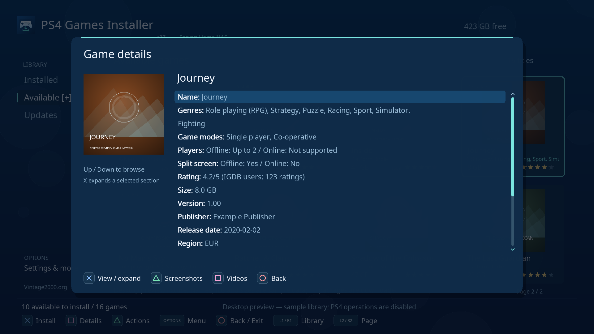

Personal descriptions override the top-level `description`; an empty remote
description falls back to `igdb.summary`. A personal 1–5 rating takes priority over
`igdb.ratings.users.score`, converted from 0–100 to five stars and marked IGDB.
These fallbacks never change `player.json`; personal collection rules remain local.
Rating sorting uses the displayed personal/IGDB score.

Up/Down selects and scrolls rows. **X** toggles the collapsed **Details** and
**Tech. details** sections. Details contains plot/storyline, developers, languages,
themes, further multiplayer information, age ratings, related games, links and local history when
provided. Tech. details contains package identity/URL, firmware and raw scalar
metadata such as `APP_TYPE`. Package URLs are percent-decoded for display only;
download requests retain the original URL exactly.

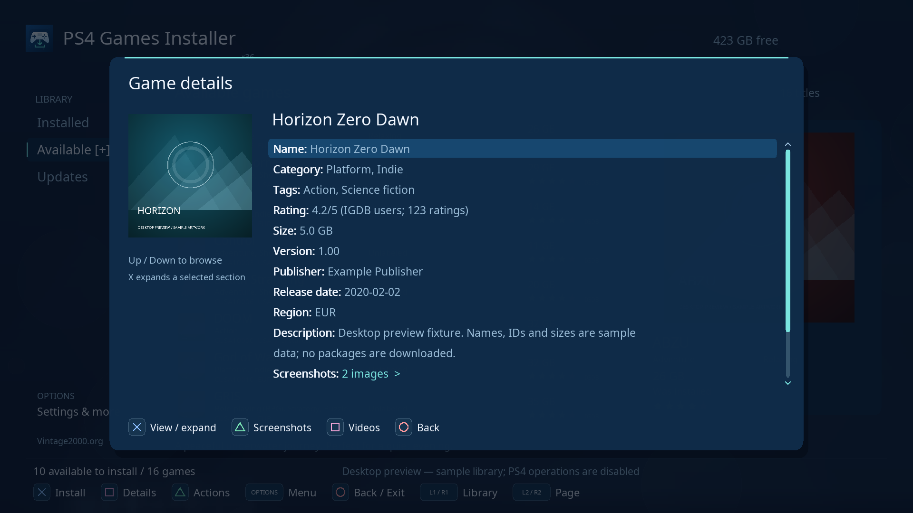

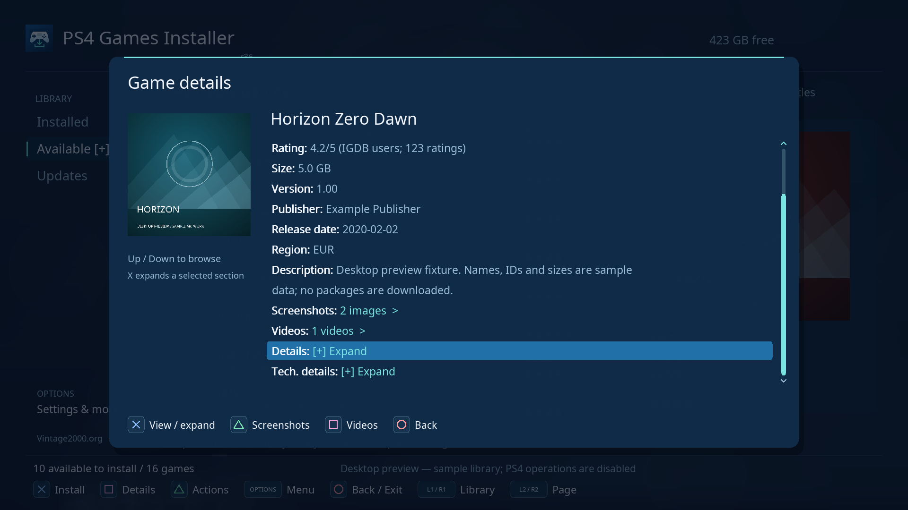

The optional embedded `igdb` object follows the companion server's tree:

```json
{
  "genres": ["Adventure"],
  "themes": ["Fantasy"],
  "publishers": ["Example Publisher"],
  "developers": ["Example Studio"],
  "summary": "General game description.",
  "storyline": "The plot.",
  "ps4_release_dates": [{"date": "2020-02-02", "region": "worldwide"}],
  "ratings": {"users": {"score": 84, "count": 123}},
  "languages": {"interface": ["English"], "voice": ["English"]},
  "media": {"screenshots": [{"url": "https://example.org/screenshot.jpg"}]},
  "videos": [{"name": "Trailer", "video_id": "abcdefghijk"}]
}
```

Screenshots/videos appear as selectable buttons only when supplied. **Triangle**
in Details opens the in-app screenshot gallery; Left/Right or L1/R1 changes image,
Triangle retries loading and O returns. **Square** opens the videos list; X opens
its HTTP(S) link in the PS4 browser after saving your library position. Video
playback depends on browser/provider support. Videos are not downloaded or played
inside the installer. O returns from the list. Missing media does not prevent
viewing other game details.

IGDB metadata is cached with the catalog, including unknown fields, without API
keys or a second matching service. Publisher/release/media enrichment also appears
for installed titles matched to a base game's exact Title ID. Limits per package:
256 KiB embedded IGDB JSON, 32 screenshots and 32 videos; PNG/JPEG images must fit
the existing 2048-pixel dimension and 8 MiB download limits. Invalid media URLs are
ignored. Gallery images retain up to 1920 pixels; decoded cover/gallery images
share a 64 MiB memory limit and a 48-image LRU cache. Refresh the remote library
after upgrading to populate the new cache.

The screenshot viewer shows the underlying download/decode error if an image
fails. **Triangle** clears that image's cached failure and retries it immediately;
**L1/R1** changes images and **O** returns to Details. `app.log` records screenshot
successes and artwork failures using cache filenames, without source image URLs.

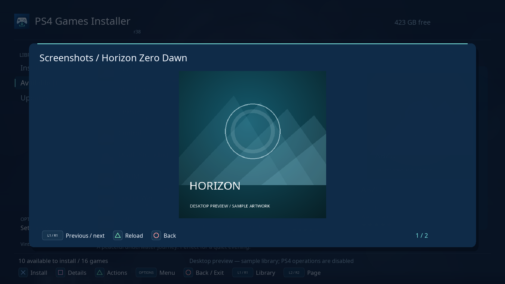

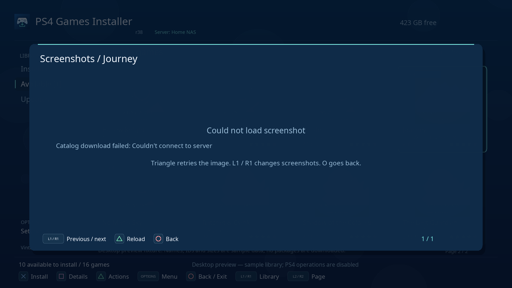

Serve catalogs as direct HTTP 200, uncompressed JSON responses. Redirects and
interactive authentication are not supported. Package hosting must support direct
URLs and correct content lengths. HTTP Range support enables background downloads
without an extra staging copy. Servers that ignore ranges use the direct-download
fallback described below. Catalog/package TLS verification remains enabled;
firmware TLS/certificate support can limit which HTTPS hosts work. On PS4, public
artwork under `https://images.igdb.com/igdb/image/upload/` uses the OpenOrbis HTTP
sample's certificate compatibility callback so firmware certificate errors do not
block these images. This exception applies only to that image origin/path;
redirects stay disabled and other artwork origins keep normal verification.

### Connection setup helper

Open **Options > Connection setup helper**, or use its row in Settings. For an
additional source, highlight it in **Other catalog sources** and press Square.
Triangle edits the URL; accepting the keyboard starts a test. Square tests again.
The helper shows the valid package count, game/update/DLC counts and missing
Title ID warnings. It distinguishes a JSON catalog from an HTML home page and
retains connection, HTTP and format errors with the source category and next checks.

After a successful test, choose **Use tested source in settings**, then **Save
settings**. O leaves the helper without applying its candidate URL. Tests read
the catalog only; each package URL is checked separately when installing. A valid
empty catalog is accepted and explicitly reported as empty. Settings also retains
the ordinary URL editor and Test connection for offline/manual configuration.

## Named server profiles

Open **Options > Server profiles**, also available in Settings. A profile stores
all catalog URLs together: Games, Updates, DLC and any additional sources. Up to
16 profiles can be named, renamed and removed on the PS4.

1. Configure your current sources, then open Server profiles and press Triangle
   (**Save copy**). Name the profile, for example **Home NAS**.
2. Press O to return to Settings and select **Save settings**.
3. To add another server, save another named copy, return to Settings, edit that
   copy's Games/other URLs, then Save settings. The first profile keeps its URLs.
4. To switch, highlight a profile and press X (**Use**). This selects it in the
   Settings draft; **Save settings** applies the switch without retyping URLs.

Triangle copies the current draft URLs to a new profile; existing profile names
cannot be overwritten by this action. Square renames the highlighted profile.
Options offers confirmed deletion. Changes stay in the draft until Save settings;
O from Settings offers to discard them. Deleting the selected profile keeps its
current URLs as Custom sources. Profiles change sources; display preferences,
personal Title ID records and existing download jobs stay shared.

The dashboard shows the active profile name. Switching loads the cache belonging
to that source set and refreshes it. If that server is offline, its cached list
remains available; when it has no cache, Available is empty. A response finishing
from a previously selected source cannot replace the newly selected library.
An ongoing package download keeps its original URL; a requested catalog refresh
waits for that transfer worker. PS4 background tasks continue independently.

Existing settings work without profiles. Their legacy offline cache is adopted
for the current sources on the first launch of this revision. Profiles and their
URLs live in `config.json`; profile backups and diagnostic exports omit them.

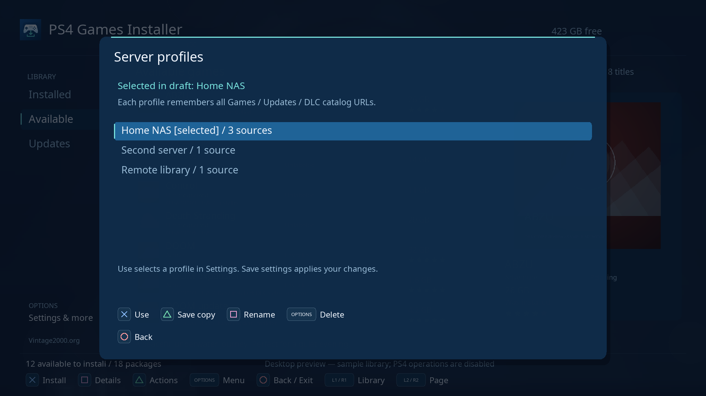

## Controls

| Button | Action |
| --- | --- |
| Left analog stick / D-pad | Navigate games, sidebar, menus and details; hold to repeat |
| Left at the first tile/list column | Focus the sidebar |
| Up / Down on the sidebar | Select Installed, Available or Updates |
| X on the sidebar | Browse the selected library |
| Right on the sidebar | Return to games |
| L1 / R1 | Switch Installed / Available |
| L2 / R2 while browsing games | Previous / next page |
| Square with the sidebar focused | Jump to letter in the current view |
| X on Installed | Launch the game |
| X on Available | Install confirmation, or actions for an installed title |
| Triangle | Game actions: launch/install, details, artwork, Assign category, Assign tags, rating, Edit local info and Uninstall for installed games; Up/Down scrolls all actions |
| Square | Game details; Up/Down browses rows, X expands a section; Triangle screenshots, Square videos |
| Options | Refresh, search, view/group/sort/filter, Settings, About and Exit |
| O | Close a window or go back |
| O on the main dashboard | Open exit confirmation; press O again to exit, X to stay |

Up/Down wraps through every selectable menu: Up on the first entry selects the
last, and Down on the last selects the first. This includes the sidebar, settings,
actions, ratings, category/tag pickers, source/profile lists, downloads and USB
pickers. Summary game lists wrap first/last; tile grids wrap top/bottom rows,
keeping the column where possible and choosing the nearest tile in a short row.
Paginated menus show a scrollbar with a position thumb and Up/Down arrows when
more entries are outside the visible page. Additional sources and scrollable
progress/details dialogs also indicate hidden content.
Left at the first tile column still opens the sidebar. L2/R2 page jumps and
game-detail rows also wrap, while L2/R2 page jumps keep their page boundaries.

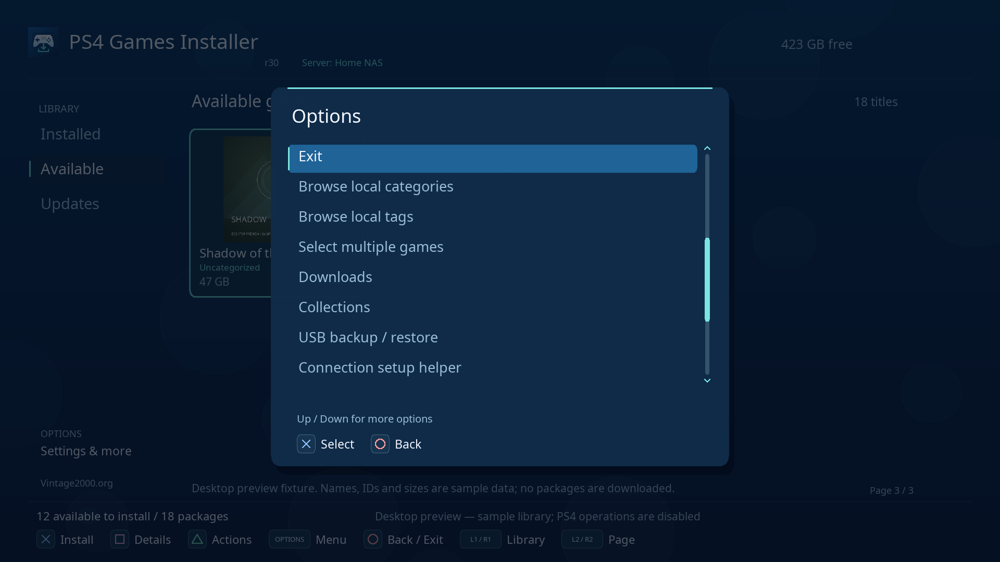

Selecting Exit from Options opens the same Circle confirmation. Settings are saved
only when Save settings is selected; Circle offers to discard unsaved edits.
Quick view/group/sort/filter changes in Options are saved immediately. **Sort**
cycles Name, Size, Rating, Last launched here and First recorded install; **Order**
selects ascending/descending. In Settings these edits remain a draft until Save.
Unknown sizes, unrated titles and missing history stay at the end in both directions.
Launch history covers this app's launch requests; first recorded install is when
this app first observed the title, not its original system installation date.
Existing `size_sort` settings migrate automatically to the equivalent new sort.
Downloads and Collections open from Options and return there with O. Updates and
sidebar focus are saved with the session. Old saved Downloads/Collections sidebar
positions migrate to the active library.
The stick has a deadzone to filter drift; the D-pad takes priority when both are
used. After closing the keyboard, release any held buttons and center the stick
before navigating again.
The loading splash is visible while startup runs, with no artificial delay.
The PS4 keyboard uses X to select a character or its Done button, and O to cancel.

Launching a game uses the PS4's normal application-switching checks, including
its confirmation to close PS4 Games Installer. Confirm that dialog to continue.
The r33 attempt to bypass it was reverted in r34 after a reported console crash.
The app saves both libraries' selections, the active library and search before
handing off to the game. Reopening returns to that selection, even if a refresh
has reordered the titles. If the title has disappeared, it selects the nearest
remaining position. A failed position save is shown before launching.

## Faster browsing and remembered searches

**L2 / R2** moves between pages: two tile rows, or eight summary rows. It keeps the
column/row position when possible and stops at the first/last page. These controls
work in Installed, Available and Updates, including grouped and filtered views.
The desktop keyboard equivalents are **Page Up / Page Down**.

Open **Options > Jump to letter**, or focus the sidebar and press Square. Only
initials present in the current view appear, with entry counts. X selects the
first visible name beginning with that letter; the current sort, grouping and
filters stay. `#` collects numbers, symbols and names outside A-Z. L2/R2 pages
through the picker, and O returns without changing selection.

**Options > Search** now lists New search, Clear current search and up to 12 recent
terms, newest first. X reuses a term immediately. Triangle opens the keyboard;
O cancels typing. Accepted nonempty terms are deduplicated and remembered across
restart. Search terms can contain up to 128 UTF-8 bytes. Clearing the current
search keeps its history and your other filters. Square offers confirmed history
clearing; it keeps the current search and saved collections.

Search history is local to this PS4 and shared between libraries/server profiles.
It is stored with the browsing session, separate from personal-record backups,
server catalogs and diagnostic exports. A failed session write shows an error;
current in-memory browsing remains available, but may not survive restart.

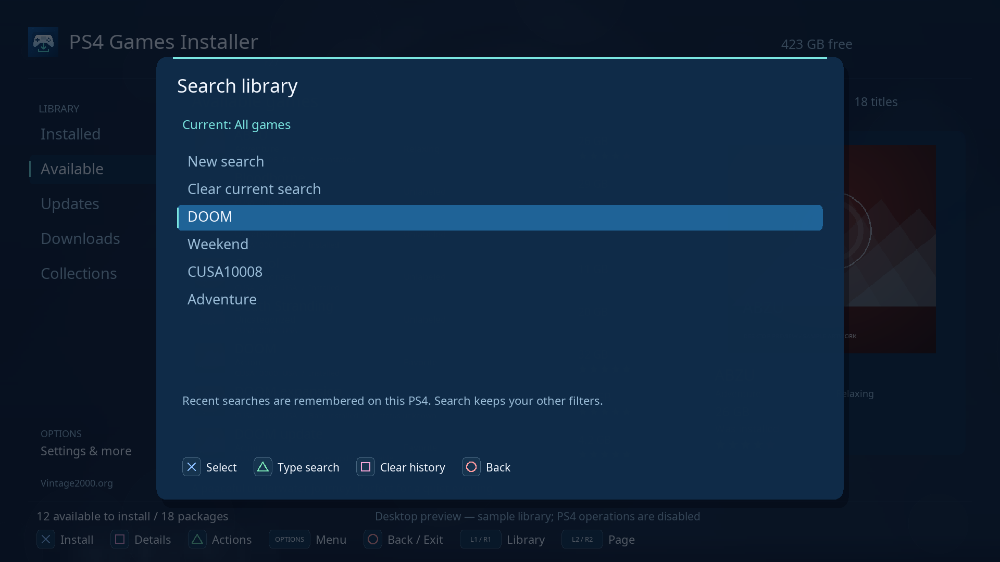

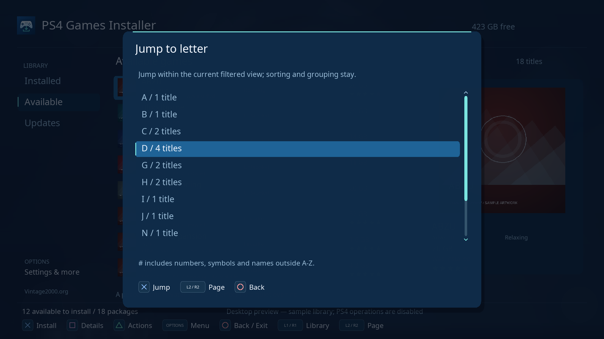

## Local ratings and history

Press **Triangle > Rate game**, choose **1–5 stars**, then press X. Choose
**Remove rating** to clear only the rating; O cancels. A valid nine-character
Title ID in the catalog is required. Versions or catalog entries with the same
Title ID share the rating and history, even if their name or package URL changes.

**Installed** means a base title is present, or the installed version meets a
known update version. DLC presence cannot be inferred from the base game alone;
its status remains unknown. **Was installed** means the app
previously observed it installed, but the latest scan does not find it. Tracking
starts with this version: games removed before it first sees them cannot be
reconstructed. Details also show the first recorded installation and launch
request count/time. These are local observations, not playtime measurements.

Records are stored in `/data/PS4-Game-Installer/player.json`, separately from
the downloaded catalog. Catalog refreshes, artwork cleanup and uninstalling a
game keep them. Back up this file to preserve ratings and history; back up
`session.json` for the last saved position and `config.json` for settings.
If `player.json` is corrupt, the app keeps it unchanged and reports an error
when a record is edited. Restore a valid backup or repair the file to resume
recording.

## Your categories, notes and tags

Select a game in **Installed** or **Available**, then press **Triangle**:

- **Assign category:** choose an existing category and press **X** to save it
  immediately. **Triangle** enters a new name, then **X** assigns it. Choose
  Uncategorized to remove the assignment.
- **Assign tags:** **X** toggles each tag, **Triangle** enters a new tag, and
  **Square** saves the selection together. Clear all game tags removes all of
  this title's personal tag assignments when saved; Genres remain unchanged.
- **O** cancels a quick assignment and returns to game actions. A failed save
  keeps the picker and your changes open for retry. Up/Down scrolls names and
  the game actions menu, including actions on its next page.


One category and up to 16 tags are stored locally per Title ID. Both libraries
and every remote package variant share them, even if the name or URL changes.
**Triangle > Edit local info** edits your category, tags and personal notes together:

- **Category:** X opens the picker. Select an existing category or Triangle to
  enter a new one. Choose Uncategorized to clear the personal assignment and reveal any IGDB genres.
- **Tags:** X toggles tags in the picker; Triangle creates a new tag. O returns
  to the editor. Clear all game tags removes this title's assignments.
- **Description:** enter your personal notes. The selected game's description
  previews above the dashboard footer; Square > Details shows its full text.
- Choose **Save local info** to write the changes. New category/tag names entered
  here are created on save. O offers to discard an unsaved draft; failed writes
  keep the draft so you can retry.

The category occupies the full row below the title on tiles and the full available
row in the summary layout. Without a personal category, this row uses IGDB genres;
otherwise it says Uncategorized. On the selected game, overflowing title/category
text scrolls within its row after a 0.35-second pause, including a pause at the other
end. Turning background animation off also pauses this text animation. Details
always exposes the full text. Your description takes precedence over a remote
one in the selected-game preview. Search matches personal categories, descriptions
and tags, plus remote genres, themes and publishers.

Local labels are removed as of r37. Older `label` keys are ignored when loading
saved data or backups and disappear on the next save. Categories, descriptions,
tags, ratings, installation history and launch records are preserved.

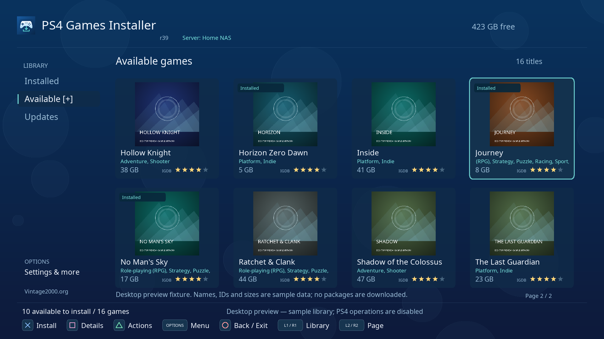


Open **Options > Browse local categories** or **Browse local tags**; scroll down
in Options to reach these entries. The browser shows counts for the current
library. X selects a filter; L1/R1 switches category/tag browsing. Category and
tag filters can be combined, and switching Installed/Available keeps them.
**All games / clear local filters** clears both; search and the installed-only
setting remain independent.

In that browser, Triangle creates a name even before any game uses it. Square
renames the highlighted name and updates every assignment. Options opens deletion
confirmation; deleting a local category/tag clears its assignments and keeps the
games, notes, ratings and history. O always goes back or cancels.

**Options > Group** and **Settings > Grouping** also offer **Local category** and
**Local tag**. A game with several tags appears under each tag, while the footer
counts each package once. Filter choices and the selected tag group are restored
with the saved session. Catalog categories such as games/updates remain separate
from your personal categories.

All of this stays in `player.json` on the PS4, survives refreshes/restarts and
remains after uninstalling a game. Existing ratings/history are preserved when
upgrading. The app reads player schemas 1–3 and writes schema 3; older releases preserve that file
without editing it. Limits are 256 local categories, 256 tags, 64 UTF-8 bytes per
name and 2047 UTF-8 bytes per description.

### Organizing several games

Choose **Options > Select multiple games**. In either library, X marks/unmarks a
game; its other package variants share the selection by Title ID. Switch libraries
with L1/R1 if needed. Triangle opens the bulk actions:

- Assign one category to the selection; X saves the chosen category.
- Add tags while keeping each game's other tags, or remove only chosen tags.
  X toggles names, Triangle enters a name, and Square saves the batch.
- Clear all tags requires a confirmation. Categories, notes, ratings and
  history stay intact.
- Select all visible games, clear the selection, or finish selecting.

O backs out of an edit; O on the dashboard ends selection mode. A batch is
validated and saved together. If one title exceeds the tag limit or writing fails,
none of the changes are applied and the draft remains available for retry.


### Saved collections

Open **Options > Collections**. X opens a collection; Triangle creates one
from the current library, search and category/tag filters. Edit its name, library,
search, category, tag, minimum/maximum stars, launch-history rule and installation
rule. X edits text; Left/Right or X cycles rules. Scroll down to **Save collection**.
O cancels the draft. Square edits an existing collection and Options deletes it
after confirmation. Up to 64 named collections are stored in `player.json`.
Zero stars means unrated; a range of 4–5 includes only your four- and five-star games.

Built-in shortcuts show no recorded launches, 4–5 star games, previously installed
games, or all games with filters cleared. Rules are evaluated against current
metadata each time the library changes. “No launches recorded” covers only launch
requests made through this app; it does not establish whether you played a game
elsewhere. A removed category/tag stays in a saved rule until edited, keeping that
collection empty rather than silently broadening it to every game. Renaming a
category/tag updates saved rules that use it.

### USB backup and restore

Connect a writable FAT/exFAT USB drive and open **Options > USB backup / restore**.
Triangle refreshes `/mnt/usb0` through `/mnt/usb7`. X exports a new, uniquely named
`PS4-Games-Installer-player-<timestamp>-<sequence>.json` file to the selected drive.
Existing backups are kept and the new file is read back for verification.

Square lists that drive's backups. Select one with X, review the replacement
confirmation, then X restores it or O cancels. The complete backup is validated
before replacement. The existing `player.json` is first preserved as
`player-before-restore-<timestamp>-<sequence>.json` in application storage, including
when the original profile is corrupt. If that recovery copy cannot be saved, the
restore stops. The selected backup replaces the profile rather than merging it.

Backups include ratings, categories, tags, descriptions, installation/launch
history and saved collections. They exclude game files, sources, network settings,
artwork, queue state and session position. USB backup drives are separate from
PS4 Extended Storage installation destinations. Actual USB behavior needs console
acceptance; the desktop preview displays sample devices and disables writes.

### Base games, updates and DLC

Use **Triangle > Game packages** on a game in either library to list all remote
packages sharing its Title ID, even those hidden by the dashboard's current filters.
Base packages appear first, then updates with newest known versions first, then
DLC. X opens install confirmation or the queue for an active package; Square shows
details and Triangle opens that package's actions. **Group: Game / Title ID** also
groups the main dashboard this way.

Details show the installed version and the latest catalog update where available.
Version comparison uses numeric dotted versions, so `1.10` is newer than `1.2`.
Malformed or missing versions remain unconfirmed. A base game's presence never
marks all DLC installed. Explicit `package_type` takes priority over the source's
category; legacy catalogs still use source categories. Correct Title IDs and
version metadata improve these views.

**Updates** in the sidebar lists update and DLC packages from configured catalogs.
Search and personal filters still apply. Tiles and summary rows identify the type
and catalog version; installed-version comparisons remain in Details and package
actions. This view does not query PlayStation services.

**Available** can expand into genre subitems supplied by `igdb.genres`. With its
sidebar row selected, Right expands while keeping sidebar focus; X expands and
enters all games. Up/Down selects a genre, and X or Right enters its games. Left
on a genre returns to all Available games and collapses the branch. Up/Down wraps
the full sidebar and its scrollbar shows hidden genres. Membership uses remote
genres even when a personal category is assigned. The genre selection and expanded
state are remembered with the library position; a removed genre clears its filter.

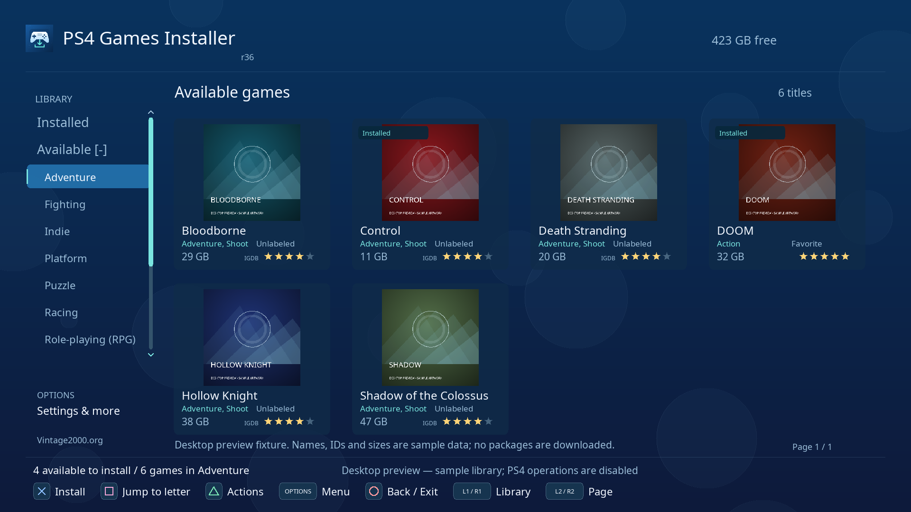

Update/DLC confirmation explains the required base Title ID. X is blocked when
that base is missing; Triangle opens **Game packages** so you can choose it first.
If its base game is already queued here, the dependent package can also be queued.
It waits until the base has finished and a fresh scan verifies it. Failure or
cancellation of the base fails dependent items with an explanation; retry after
resolving the base. Other eligible queue items can proceed while a dependency waits.
The app checks the console's installed state again before fetching/submitting an
update or DLC, including after restart.

Catalog authors may add `"required_base_version": "1.10"` to an update/DLC entry.
When present, it must be a numeric dotted version and the installed base must meet
it. This requirement survives queue restarts. Without it, only base presence and
exact Title ID can be checked. Catalog `min_fw` is shown as advisory information;
firmware/backport compatibility and region/package compatibility are not inferred.


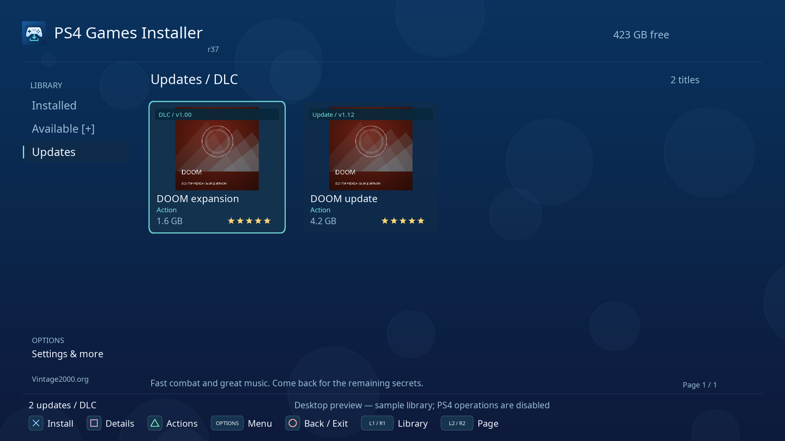

## Installation storage

Open **Options > Settings > Installation destination**. Use Up/Down to highlight
**Internal storage** or **External USB**, then press **X** to apply. The selected
destination is marked `[Selected]`. This changes the PS4's **Application Install
Location** preference for new installations, including installations outside this
app. It takes effect immediately and persists independently of Save settings.
Existing games stay on their current drive. Registry errors or readback failures
are displayed instead of claiming the selection worked.

Press Triangle to check capacities again after connecting or disconnecting a drive;
Circle returns to Settings and preserves unsaved URL/display edits. An unavailable
drive cannot be selected. The app does not format drives.
If capacity cannot be read, the panel says **Space unavailable**; a successfully
read, full drive shows **0 B free**. r19 bypasses a broken SDK capacity wrapper
that returned empty results in r17. Correct console capacities still need retesting.

A plain exFAT/FAT32 USB package source is not a PS4 Extended Storage installation
destination. See [PlayStation's Extended Storage instructions](https://www.playstation.com/en-ca/support/hardware/ps4-external-hdd-support/)
for configuration and compatibility. Console testing of external installations is
still pending for the new r17 selector on PS4 11.00 + GoldHEN.

## Downloads and offline use

Open **Options > Downloads** to manage up to 200 tracked packages. Installing
adds a persistent waiting item, including when another transfer is running. Package
preflights/direct downloads run one at a time; accepted PS4 tasks continue in the
background and have a separate progress monitor.

PS4-managed remote transfers show Downloading until their data transfer finishes,
then Installing. Staged local package copies stay in Installing. Queue records from
earlier releases with unknown transfer mode retain their generic installation status.

The queue distinguishes **Queued**, **Checking URL**, **Downloading**, **Registering
with PS4**, **Installing**, **Verifying installation**, **Completed**, **Failed**,
**Cancelling** and **Cancelled**. Transfer percentages, bytes, speed and approximate
download time are shown when available. They do not measure installation progress.
X opens diagnostics; X in diagnostics retries a failed or cancelled item.

Triangle in diagnostics offers **Cancel task** for active/waiting items or a tracked
PS4 task. Confirm with X; O returns without cancelling. Waiting items stop waiting,
active direct transfers are interrupted, and owned PS4 tasks are stopped and
unregistered. A cancellation error keeps task ownership and its staging file.
For inactive history without a tracked task, Triangle offers **Remove entry**.
Confirming removes only that queue record; installed games, local game records and
saved packages are kept. Options on the queue clears finished history while
keeping active tasks.

Installation keeps the original queue stages and Data percentage labels. After a
base-game task finishes, native completion plus a fresh installed Title ID confirms
installation even when the catalog version differs from the package actually
installed. Diagnostics show both versions if they differ. Native completion alone
cannot confirm a missing base title. Updates still require the expected installed
version. An old installed copy alone cannot prove a disappeared task succeeded;
without native completion its version must advance. DLC/themes use native completion
because they do not get their own game tile. A 100% download alone does not confirm
installation. Unconfirmed results time out to Failed after two minutes.

A saved verification-timeout failure with native completion is rechecked against
fresh installed evidence on startup or refresh. A confirmed result becomes Completed
without another download. Actual task errors and unknown outcomes retain their
saved failure. Temporary r30 Needs verification entries resume verification. A
released task ID keeps the original **not registered / released** label.

A released task awaiting verification does not block X launching a game from
Installed; its package stays queued to prevent another installation while checks
continue. Active or tracked installation tasks still block the main launch button.
Check PS4 Notifications > Downloads for system task details.

Queue/history and owned task IDs survive restart. Waiting items resume scheduling
when the app reopens. Interrupted preflight/direct-transfer items require Retry;
complete staged packages can be reused, while partial transfers start over. Invalid
queue files are preserved and block new queue writes until repaired.


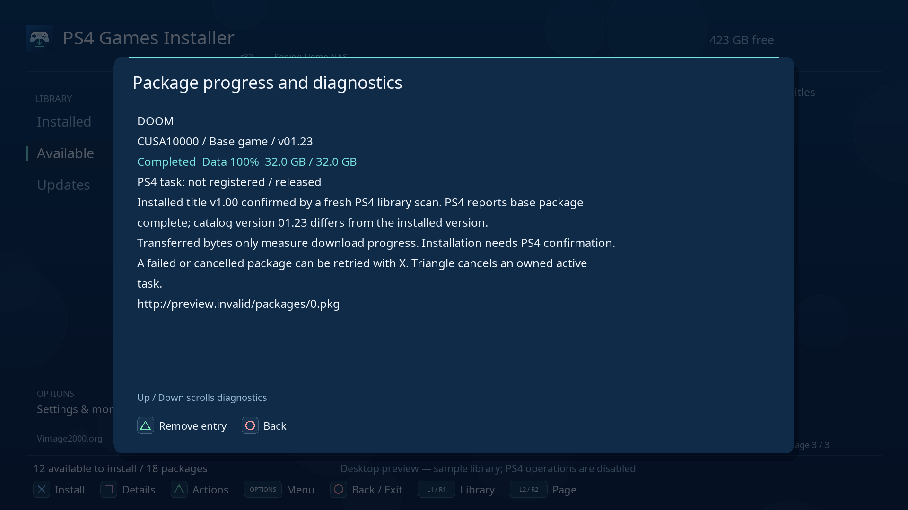

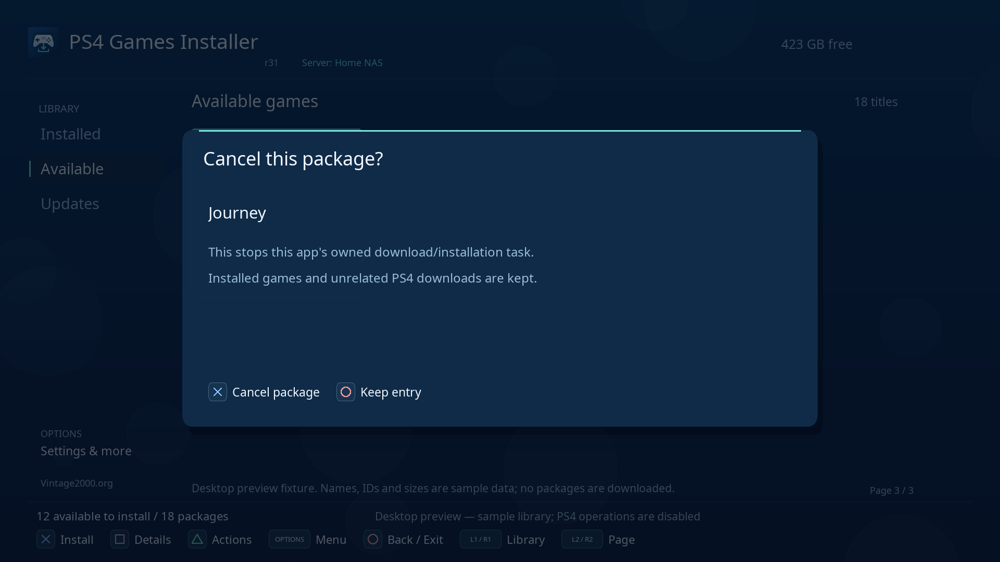

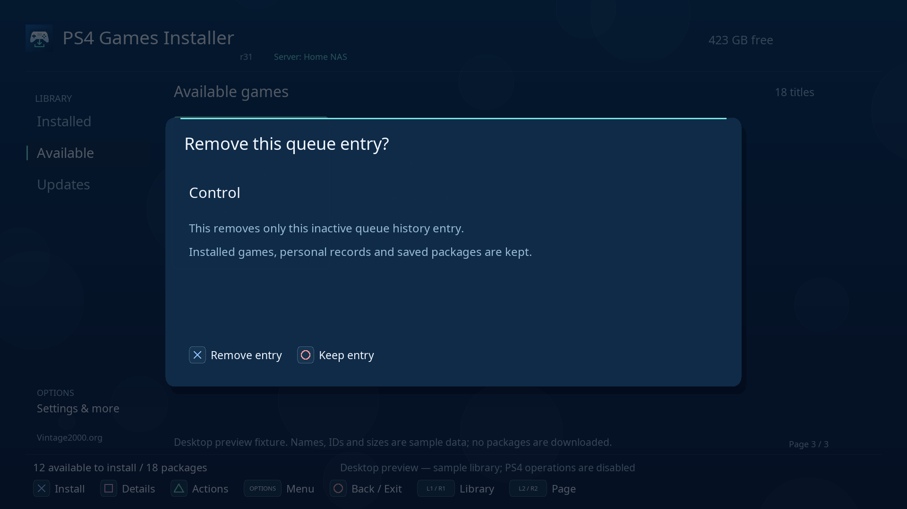

The app checks the actual PKG URL with a small GET range request before submitting
it. A 404, HTML response or invalid package signature is reported before creating
a PS4 task. A server that responds with HTTP 206 uses BGFT directly.

When the server ignores ranges, the app streams the package to
`/data/PS4-Game-Installer/downloads/`, then submits that local file to BGFT. This
works around package servers that do not implement Range/HEAD correctly. **Keep
the app open during the direct download.** Its percentage is shown in the status
bar. Exiting cancels an unfinished transfer and removes the partial file. Internal
storage needs room for the staging copy plus 64 MiB reserve, even when installing
onto Extended Storage. Installing to internal storage also needs room for the
installed game. Enable Range support on the server to avoid this extra copy.

**The download percentage measures the package copy, not installation.** After
100%, the app still needs the PS4 to accept an installation task. A refusal opens
an **Installation failed** dialog with the actual error; X offers Retry and O
closes the dialog. A complete staging file is kept and reused on retry.
For duplicate errors `0x80990086` or `0x80990015`, the app looks up the exact
Content ID. When installing a validated local PKG, it can release an old failed
task for that exact package and retry registration once, including tasks left by
an earlier revision. It rechecks the identity and failed state before release;
active tasks and tasks identified only by remote catalog metadata are kept.
If release fails, the dialog shows that error and keeps the package. Finish or
cancel the matching entry in PS4 Notifications > Downloads, then retry. If no
matching task can be confirmed, close the app, fully restart the PS4, enable
GoldHEN and retry. The reported failed-task installation case is confirmed working
on PS4 hardware with r28; the remaining task-state scenarios are tracked in TODO.md.

Once a task is submitted to BGFT, closing this application does not cancel it.
Use this app's queue or **PS4 Notifications > Downloads** for task details and
cancellation. The app retains task IDs between launches and polls
progress while running. A completed transfer may still be installing. Failed owned
tasks are unregistered before allowing a retry. A staging copy is retained until
its task is removed or BGFT confirms installation/copy completion and unregisters
the task. Reopen the app to reconcile tasks and release these copies. Registration
errors keep a complete staging file so retrying does not download it again.

**Upgrading from r16:** r28 can recover failed tasks even when the earlier revision
lost their tracking IDs, provided the complete local PKG identifies the exact
content and PS4 confirms the task is still failed. Other old entries may still
need cancellation in PS4 Notifications > Downloads before retrying.

Existing-title conflicts are reported without automatically uninstalling a game.
To remove an installed game, select it in Installed and choose **Triangle >
Uninstall**, then X to confirm or O to cancel. Its local rating and history are
kept. Forced replacement and staging to a plain USB package-source drive are
not offered.
An installed title may require its external drive or original disc to launch.
If an earlier revision reports `Resolve game launcher: 0x80020003` or
`Load game launcher: 0x80020002`, install r17 or later. The launcher now imports
the packed LncUtil library from SystemService; the generated executable's import
table is checked during packaging. The user confirmed r17 launching works.

A failed refresh keeps the last valid library. Installed discovery is independent
of the network; cached remote metadata and covers remain available offline. Limits:
8 MiB per catalog/artwork download (packages stream separately), 50,000 combined
entries, 64 MiB offline catalog, PNG/JPEG
covers up to 2048×2048, 48 decoded covers and a 128 MiB disk artwork cache.
Use Settings to clear artwork or Triangle to refresh one game's artwork.

## Storage cleanup

Open **Options > Storage cleanup**, also available in Settings. The screen shows
artwork-cache size, package-staging size, reclaimable bytes/files and protected
bytes/files. Triangle refreshes these figures. X offers confirmed staging cleanup;
Square offers confirmed artwork cleanup. O cancels either confirmation.

Staging cleanup rechecks the files and current tracked jobs when submitted. It
removes inactive partial downloads and complete packages explicitly marked released.
It keeps queued/owned transfers, packages possibly still used by PS4, unmarked
packages left by older revisions, unrelated files and symlinks. Corrupt queue
tracking disables staging cleanup. New packages cannot enter the queue during the
cleanup itself. Removing a released complete file means a later Retry downloads it
again. Artwork is fetched again as needed; games and personal records stay intact.

A small `.pkg.lease` file records whether PS4 might still need a staged package.
Ambiguous registration errors keep it protected, including after an app crash.
If starting a registered task fails and PS4 cannot release it, the app keeps that
owned task ID for cancellation and protects its package. Do not manually remove
protected files while the system might be using them.

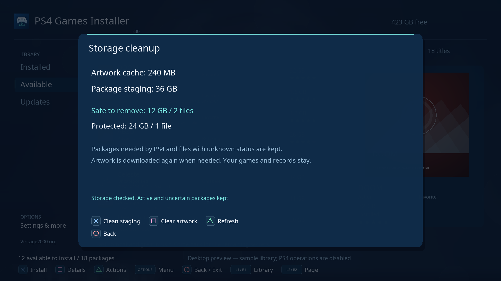

## USB diagnostic export

Open **Options > Export diagnostics to USB**, also available in Settings. Connect
a writable FAT/exFAT USB drive, refresh with Triangle, select it and press X.
The app rechecks the drive and writes/readbacks a new
`PS4-Games-Installer-diagnostics-<timestamp>-<sequence>.json` report. Existing files
and personal-record backups are kept; diagnostic reports never appear in Restore.
PS4 Extended Storage is a game destination, not an ordinary USB export drive.

The report contains the application revision, library counts, storage availability,
last measured cache usage, queue stages, Title IDs, numeric versions, task IDs,
transfer bytes and selected native/HTTP error codes. Raw logs, package/source URLs,
credentials, cookies, game names and personal notes/tags are excluded.
Only recognized operation labels and error-code formats are extracted from the
bounded log tail; lines mentioning credential fields are discarded. This deliberately
omits diagnostic context that could contain private data. The report does not change
or sanitize the original local `app.log`. The desktop preview disables USB writes.

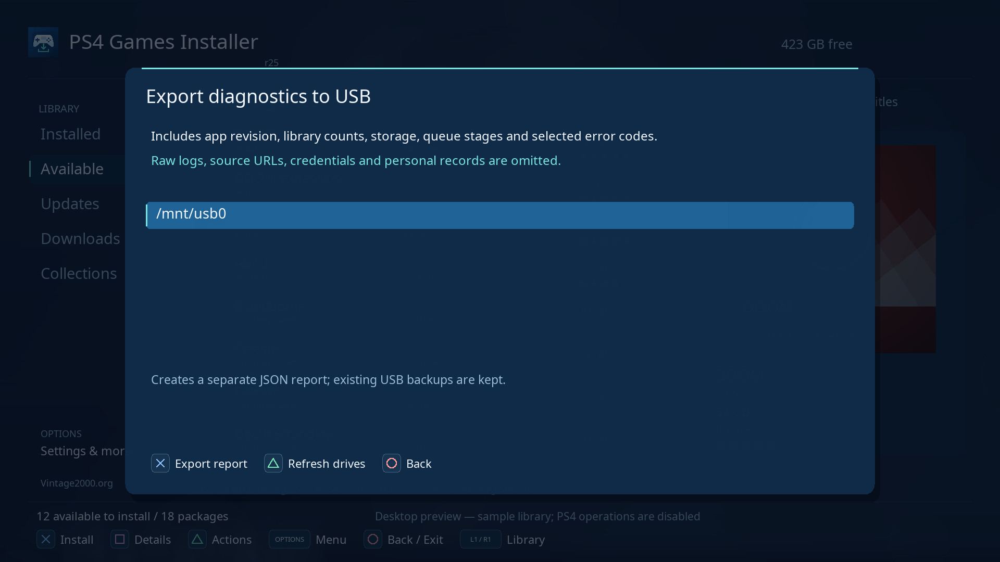

## Data and troubleshooting

The console stores its files under `/data/PS4-Game-Installer/`:

- `config.json`: saved sources, named server profiles and display preferences; see config.example.json.
- `catalog-<source-key>.json`: offline catalog for a particular set of source URLs.
- `catalog.json`: compatibility copy of the latest accepted catalog; adopted once for legacy settings.
- `catalog-cache-v1`: marker preventing legacy-cache adoption after later URL changes.
- `player.json`: personal Title ID records and saved collection rules (schema 3).
- `session.json`: library selections, Updates mode, genre/expanded sidebar, search/history and active filter rules.
- `queue.json`: waiting/active/finished items, base dependencies, progress and task ownership.
- `tasks.json`: compatibility copy of submitted task IDs from earlier releases.
- `player-before-restore-*.json`: recovery copies made before USB restores.
- `artwork/`: disposable cover cache.
- `downloads/`: private package staging and `.pkg.lease` ownership markers; use Storage cleanup for released files.
- `app.log`: recent operation results and service errors.

On the first launch of r13 or later, this app's previous
`/data/PS4-Games-Installer/` directory is moved to `/data/PS4-Game-Installer/` when
the new directory does not exist. Saved settings, catalog, tasks and artwork stay
together. An existing new directory takes precedence.

| Problem | Check |
| --- | --- |
| Cannot open `/app0/assets/icon.png` at startup | Install r7 or later; the startup asset-loading order was corrected |
| System keyboard types with O and closes with X | Install r9 or later; package metadata now requests X confirm / O cancel for native dialogs |
| r36 crashes on remote refresh or next startup | Install r37 or newer. Large JSON printing now avoids the toolchain allocator shrink path. Existing valid catalog/personal data can be kept; startup and refresh phases are recorded in app.log. |
| CE-34878-0 when closing the app | The reported exit crash was confirmed fixed by the user on 2026-10-16. r8 introduced credential restoration and exit through the PS4 shell. |
| Empty Available | Set the direct JSON URL, use Test connection, then Refresh library |
| HTTP 404 from the companion server | Use its `/games` link on the JSON library port |
| Install HTTP 404 / CE-40852-9 | Update to r17, cancel failed r16 tasks in PS4 Downloads and retry. The app checks the PKG URL and stages downloads when the server ignores ranges. A 404 during the initial check means that package URL still needs correcting on the server. |
| Covers or installation fail | Check the URLs inside the JSON and package/artwork server reachability |
| Installed is empty | Confirm GoldHEN is active, reconnect external storage, refresh, and inspect app.log |
| Installed only shows a few games | Update to r17 and refresh. Patched games use `gp` app metadata, which earlier builds incorrectly excluded. |
| Installed titles appear without their icons | Install r10 or later, which looks up icons separately from private metadata. Use Options > Refresh library after reconnecting Extended Storage |
| Launch fails | Close another running game and check the title's storage/disc and displayed service error |
| App closes when launching a game | Normal PS4 application switching; r19 saves the library selection before launch |
| Download crashes with CE-34878-0 | Update to r19 for heap transfer buffers and larger worker stacks; console retesting is pending. Preserve `app.log` and the crash dump if it recurs |
| Installation storage always shows 0 B | Update to r19 for the native capacity query, then Triangle to check again |
| Installation refused / already queued | Read the failure dialog. Manage the matching task in PS4 Downloads; if none can be confirmed, restart PS4, enable GoldHEN and retry. r20 reuses the complete package |
| Existing-title conflict | The installed title was preserved; this app does not force removal |
| Settings cannot save | Check free space and access to the application data directory |
| URL is saved but Available stays empty | Read the connection result in Settings and use a direct JSON URL, such as `/games`. For `Disable redirects (0x80431001)`, update to r15 or later, which binds every HTTP operation to one client module. The user subsequently confirmed artwork downloads work. |
| HTTPS fails | Check server certificates and firmware TLS compatibility; a private LAN HTTP server is supported |

PS5, database repair, system-menu replacement and automatic game removal are outside
this version. Runtime service behavior and frame rate still require console testing.


See [CHANGELOG.md](CHANGELOG.md) for release history and [TODO.md](TODO.md) for
feature-specific console acceptance checks.
