# PS4 Games Installer

Browse a remote game catalog, install packages, and launch your installed PS4
games from one dashboard. Choose tiles or a summary list, view game details,
track downloads, and organize your collection with local ratings, categories,
tags and notes.

Works only on a **jailbroken PS4**; tested on **PS4 11.00 + GoldHEN**.
Created by **e1z0 — (c) 2026 Vintage2000.org**.

[Project](https://github.com/e1z0/PS4-Games-Installer) ·
[Releases](https://github.com/e1z0/PS4-Games-Installer/releases)

## Screenshots

PS4 captures. Click a picture to open it at full size.

  <a href="Screenshots/20261017_001035_00608253.jpg">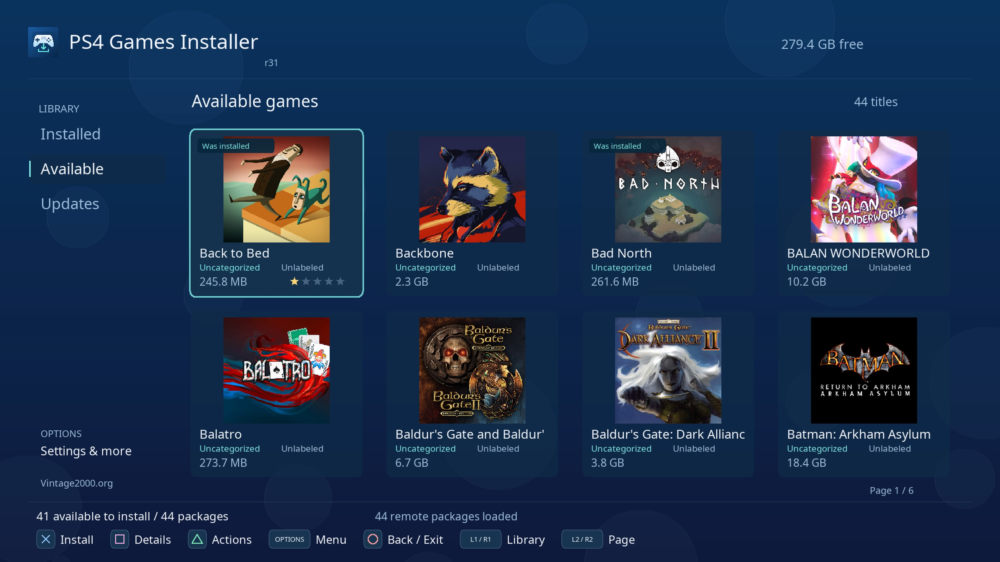</a>
  <a href="Screenshots/20261017_001051_00880498.jpg">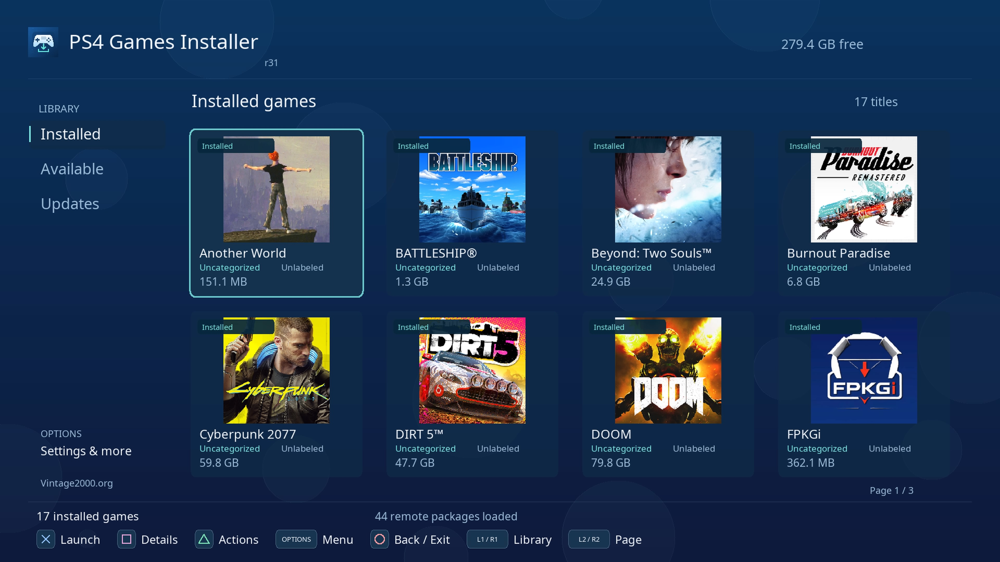</a>
  <a href="Screenshots/20261017_001111_00700425.jpg">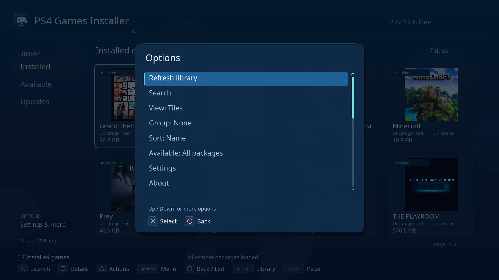</a>

  <a href="Screenshots/20261017_001141_00874224.jpg">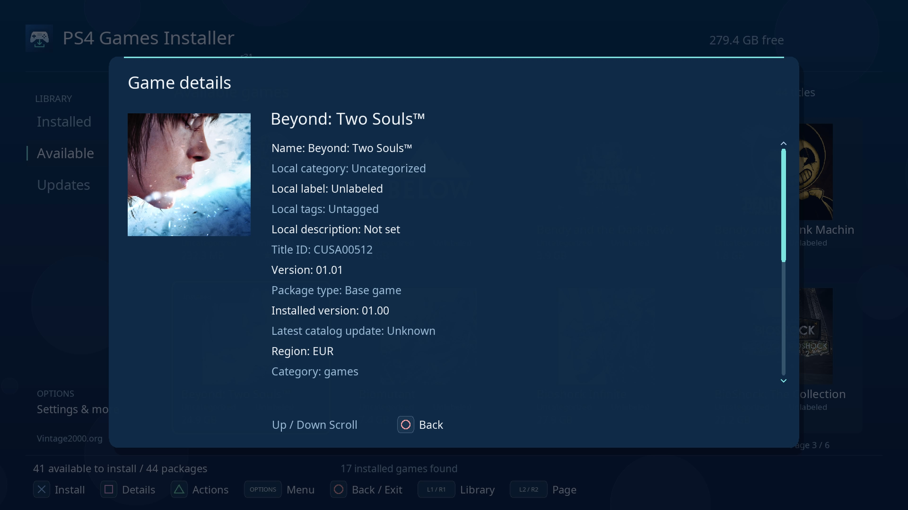</a>
  <a href="Screenshots/20261017_001202_00676251.jpg">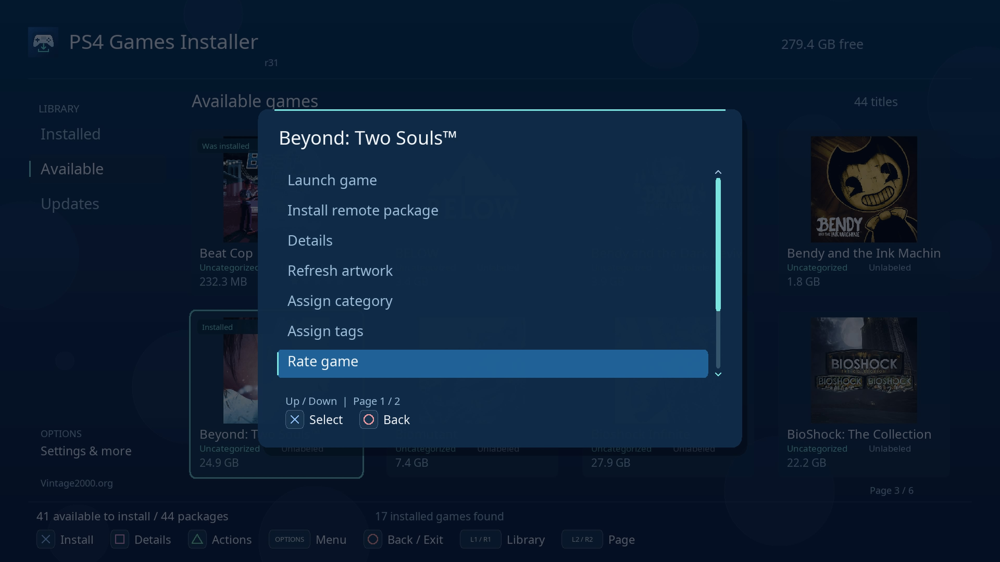</a>
  <a href="Screenshots/20261017_001231_00636497.jpg">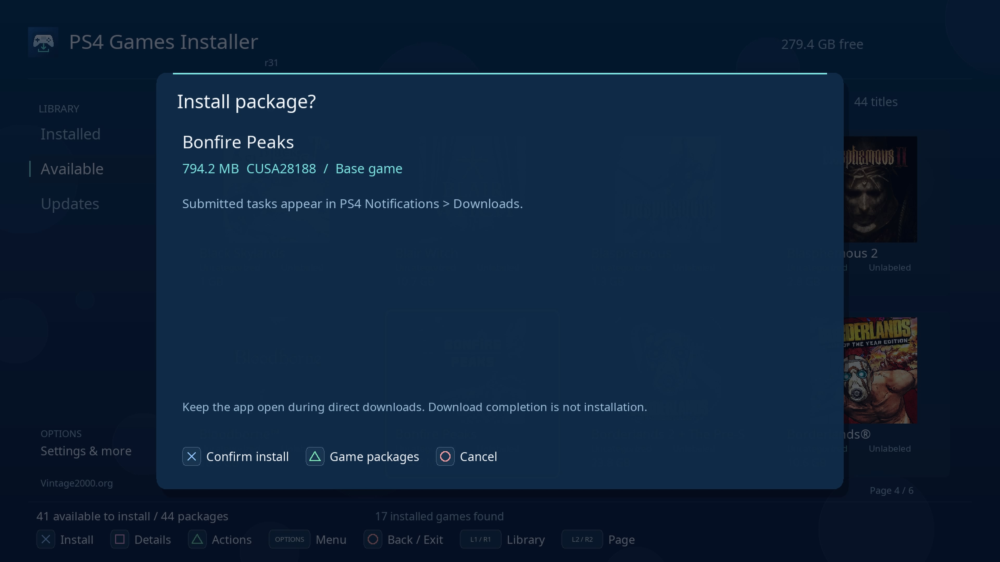</a>

  <a href="Screenshots/20261017_001249_00743509.jpg">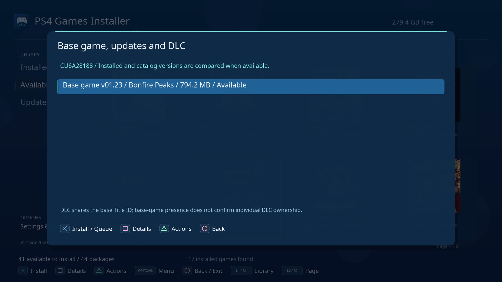</a>
  <a href="Screenshots/20261017_001259_00052288.jpg">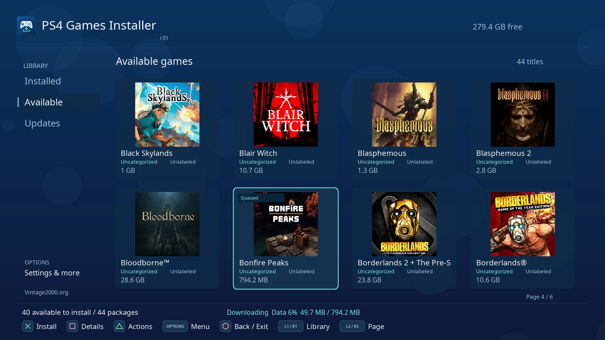</a>
  <a href="Screenshots/20261017_001335_00459221.jpg">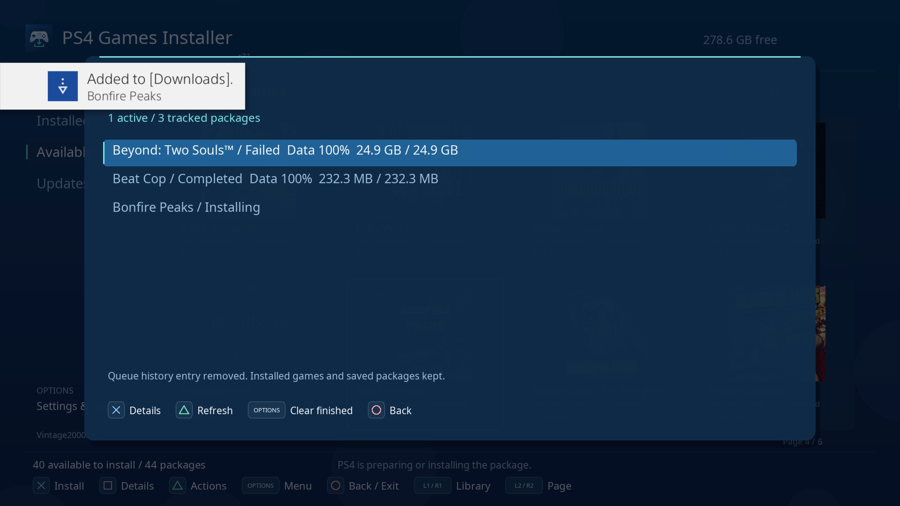</a>

  <a href="Screenshots/20261017_001351_00816238.jpg">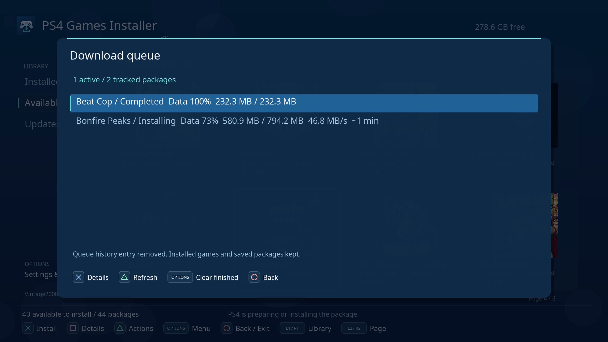</a>
  <a href="Screenshots/20261017_002539_00456334.jpg">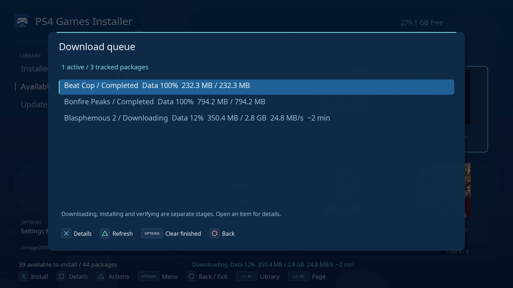</a>

## Install and set up

Works best with [FPKGi-node-server](https://github.com/e1z0/FPKGi-node-server),
which generates and hosts the JSON game library. Follow its setup guide, then use
the generated library URL in the steps below.

1. Enable GoldHEN and install `PS4Game_installer-rN.pkg` using your PS4 package installer.
2. Open **PS4 Games Installer**, then **Options > Settings**.
3. Enter your server's **Games JSON URL**, for example `http://192.168.1.10:3000/games`.
4. Choose **Test connection**, then **Save settings**.

Use the direct JSON address supplied by your catalog server. The server and its
package/artwork URLs must be reachable from the PS4. Settings also lets you add
other catalog sources, choose a layout, and turn background bubbles on or off.

## Controls

| Button | Action |
| --- | --- |
| D-pad / left stick | Navigate games and menus |
| X | Launch an Installed game; confirm installation on Available |
| Square | Game details |
| Triangle | Game actions, ratings, categories, tags and Uninstall |
| Options | Search, view/group/sort, Downloads, Collections and Settings |
| O | Back or cancel; on the dashboard, open exit confirmation, then O exits |
| L1 / R1 | Switch Installed / Available |
| L2 / R2 | Previous / next page |

Move left from the first game column to reach the sidebar. Menus wrap at both
ends; scrollbars show when more entries are above or below. The PS4 keyboard uses
X to select characters or Done, and O to cancel.

## Browse, install and play

- **Installed:** select a game and press **X** to launch. Your selected game and
  library are remembered when you reopen the installer.
- **Available:** press **X** to install a game. On the sidebar, **Right** expands
  genres from your catalog; **Left** collapses them.
- **Updates:** browse update and DLC packages; their matching base game is required.
- **Triangle > Game packages:** find a title's base game, updates and DLC together.
- **Triangle > Show screenshots:** open the gallery when the catalog supplies images.

**Square** opens Game Details. Local notes replace the remote description;
Genres and assigned Tags are separate, followed by game modes, player counts
and split-screen support. IGDB ratings fill in missing personal ratings. Use **X**
to expand Details or Tech. details, **Triangle** for screenshots and **Square**
for videos (opened in the PS4 browser), when the catalog provides them.
In the screenshot viewer, use **L1/R1** to browse and **Triangle** to retry a failed image.

Open **Options > Downloads** to check progress. X opens an entry's diagnostics;
X there retries a failed/cancelled item. Triangle offers **Cancel task** for an
active task or **Remove entry** for inactive history, with confirmation.
Removing history keeps the installed game.

**Keep the app open during direct downloads.** PS4 background tasks can continue
after it closes. Reaching 100% downloaded does not mean installation has finished;
wait for **Completed**. Use **PS4 Notifications > Downloads** for system task details.

To choose a destination, open **Options > Settings > Installation destination**.
External USB installation requires a connected **PS4 Extended Storage** drive;
an ordinary USB file-storage drive is used for backups instead. Changing the
destination also changes the PS4's default location for new installations.

## Organize your games

Use **Options** to search, switch Tiles/Summary, group, sort and filter the library.
Selected long game names and categories scroll inside their tile when animation is on.
Choose **Triangle > Rate game** for 1–5 stars, **Assign category** for a category,
or **Assign tags** to toggle tags with X and save them with Square.
**Edit local info** edits your category, tags and personal notes. These records stay on your
PS4 and survive catalog refreshes and uninstalling a game.

**Options > Collections** saves reusable views. **Select multiple games** applies
categories/tags to several titles. **USB backup / restore** exports personal
records to a writable FAT/exFAT USB drive; it does not back up game files.
To remove a game, select **Triangle > Uninstall** and confirm.

## Help and manuals

If Available is empty, check the JSON URL, test the connection and refresh the
library. If an install or launch fails, read the displayed error, check storage
and PS4 Downloads, and refresh Installed. **Options > Storage cleanup** frees
released package/cache files; **Export diagnostics to USB** helps investigate errors.

- [Expert manual](EXPERT.md): catalog servers, advanced configuration, profiles,
  backups, storage and troubleshooting.
- [Development manual](DEVELOPMENT.md): Linux/Docker builds, testing and deployment.
- [Changelog](CHANGELOG.md) · [License](LICENSE) · [Credits](THIRD_PARTY.md)
