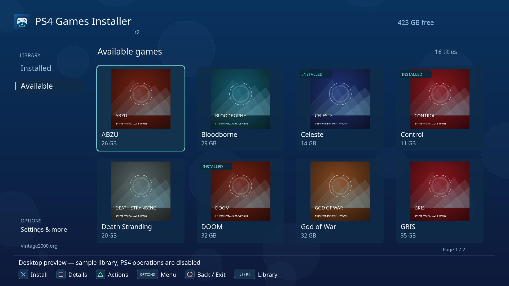
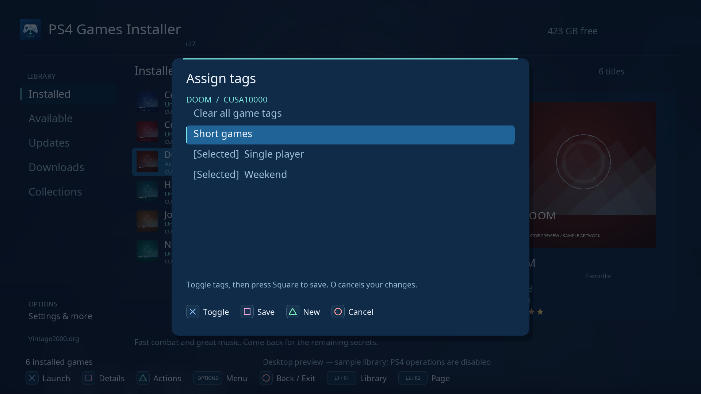
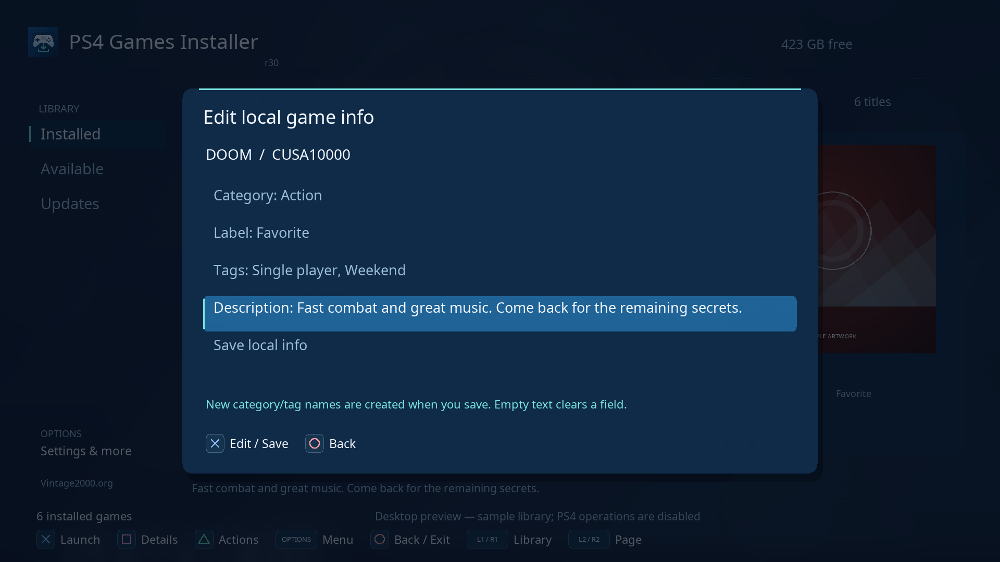
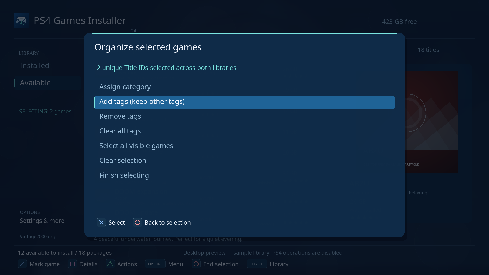
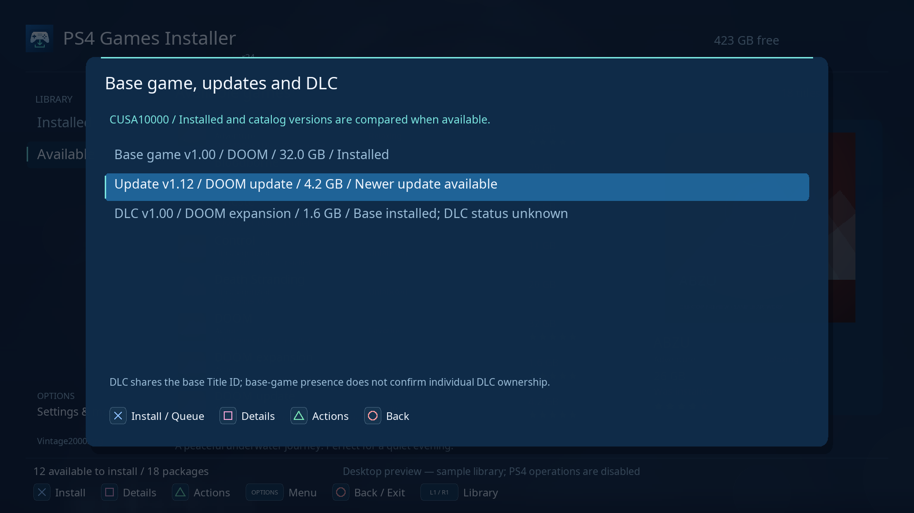
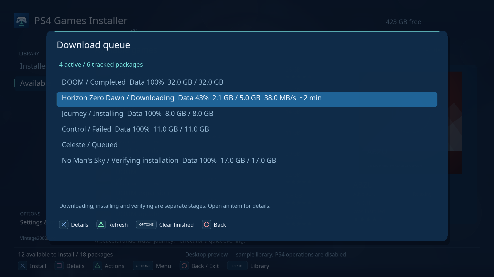

# PS4 Games Installer

A native PS4 library, game launcher and remote package installer built with the
OpenOrbis toolchain. Created by **e1z0 — (c) 2026 Vintage2000.org**.

[Project](https://github.com/e1z0/PS4-Games-Installer)

**Confirmed running on real hardware: PS4 11.00 + GoldHEN** (user confirmation,
2026-10-16). Source URL entry through the PS4 keyboard and settings saving are
confirmed working, remote artwork downloads work, and the reported exit crash is
fixed. In r17 the user also confirmed game launching, analog navigation and the
complete Installed library. r19 completed direct downloads in the subsequent
hardware test, but PS4 registration rejected the tested package. r20 corrects
local registration paths and retry caching; successful installation still needs
console confirmation. The application builds
on Linux and its package validates; individual feature checks are tracked in
[TODO.md](TODO.md).
It requires an active homebrew environment; this app does not install GoldHEN.

## What it does

- **Installed:** discover registered games and homebrew on the console, show their
  local icons and metadata, and launch them with X. Triangle includes Uninstall
  with a separate confirmation. This works without a server.
- **Available:** browse the complete remote catalog, with installed and queued
  badges, plus **Was installed** for titles recorded on this console previously.
  X opens an installation confirmation. Range-capable servers use the PS4
  background installer; other servers use a direct-download fallback first.
- Switch between a cover tile grid and a summary list. The summary background
  follows the selected game's artwork. Group by category, region, first letter,
  local category, tag or game/Title ID, or none; sort by name or size and optionally hide
  installed remote titles.
- Edit catalog URLs with the PS4 on-screen keyboard, test connectivity, and save
  settings from the app. No FTP configuration is needed for normal setup.
- View detailed metadata, search the current library, and use an offline catalog
  and bounded artwork cache. The blue background has optional floating bubbles.
- Rate games from 1 to 5 stars using Triangle > Rate game. Stars appear on tiles
  and in the summary list. Ratings and history stay local across catalog updates.
- Add your own category, label, description and tags to any Title ID. Browse
  local categories/tags, keep notes and organize both libraries without editing
  the server's catalog.
- Resume the selected library and game after launching a game or exiting the app.
  The bottom-left counter follows the current library and shows packages ready
  to install on Available.
- Organize several games together, save reusable collection rules, and back up
  personal records to USB without copying game files.
- Track a persistent download queue with retry/cancel, separate installation
  verification, transfer rates and approximate remaining download time.
- Browse a game's base packages, updates and DLC together, with installed and
  available versions where the catalog supplies them.

**Background animation** in Settings controls the flowing bubbles in both Tiles
and Summary list. It is on by default; switching it off leaves a still background.



The preview uses original sample artwork and fictitious IDs/sizes. On the console,
Installed reads local game icons; Available uses your server's `cover_url` images.
Installed artwork is read from `/user/appmeta/<TITLE_ID>/icon0.png` or
`/user/appmeta/external/<TITLE_ID>/icon0.png`, independently of the private title
metadata directory. It does not require a configured server or Internet access.

## Install and set up

1. Build the package below, or obtain a package from this project's releases when
   one is published. The filename is `PS4Game_installer-rN.pkg`.
2. Activate GoldHEN and install the package with your existing package installer.
3. Launch **PS4 Games Installer**, press **Options**, and choose **Settings**.
4. Select **Games JSON URL**, enter the catalog URL, and confirm the keyboard.
5. Choose **Test connection**, then **Save settings**. The library refreshes after
   a source change. Other sources can be added under **Other catalog sources**.

Accepting the keyboard updates a draft. **Save settings** writes
`/data/PS4-Game-Installer/config.json` and keeps Settings open with a visible
confirmation. Connection results and save errors appear inside the Settings window.
If saving fails, the edited draft is kept for another attempt.

The title ID is `PGIN00001`.
Sizes use decimal GB/MB. Installed size and remote package size are separate fields;
unknown values are shown as unknown.

## Using a companion catalog server

Use a companion server that scans your packages, extracts PS4 icons, and serves
catalogs, artwork and package files. Follow your server's Linux/Docker setup
instructions.

Use the JSON link from its catalog page. For example, with its JSON library server
on port 3000:

```text
http://192.168.1.10:3000/games
```

That server's `/games` endpoint serves `games.json`; entering `/games.json` on that
port would request `games.json.json`. A different web server can use any direct JSON
URL, including one ending in `.json`.

The JSON server and package/artwork server may use different ports. The addresses
inside the catalog must also be reachable from the PS4. Advertise your server's LAN
IP or DNS name rather than `localhost`, `127.0.0.1`, or `0.0.0.0`.

The existing catalog format is supported:

```json
{
  "DATA": {
    "http://192.168.1.10:8080/packages/example.pkg": {
      "name": "Example homebrew",
      "title_id": "BREW00000",
      "region": "EUR",
      "version": "1.00",
      "release": "10-15-2026",
      "size": "32000000000",
      "min_fw": null,
      "cover_url": "http://192.168.1.10:8080/covers/example.png"
    }
  }
}
```

A name and direct HTTP(S) package URL are required. Metadata may be missing or null;
size accepts integer bytes or a decimal string. Title IDs enable installed-status
matching. Details also retain additional string metadata supplied by the server.

Serve catalogs as direct HTTP 200, uncompressed JSON responses. Redirects and
interactive authentication are not supported. Package hosting must support direct
URLs and correct content lengths. HTTP Range support enables background downloads
without an extra staging copy. Servers that ignore ranges use the direct-download
fallback described below. TLS verification remains
enabled; firmware TLS/certificate support can limit which HTTPS hosts work.

### Connection setup helper

Open **Options > Connection setup helper**, or use its row in Settings. For an
additional source, highlight it in **Other catalog sources** and press Square.
Triangle edits the URL; accepting the keyboard starts a test. Square tests again.
The helper shows the valid package count, game/update/DLC counts and missing
Title ID warnings. It distinguishes a JSON catalog from an HTML home page and
retains connection, HTTP and format errors with the source category and next checks.

After a successful test, choose **Use tested source in settings**, then **Save
settings**. O leaves the helper without applying its candidate URL. Tests read
the catalog only; each package URL is checked separately when installing. A valid
empty catalog is accepted and explicitly reported as empty. Settings also retains
the ordinary URL editor and Test connection for offline/manual configuration.

## Controls

| Button | Action |
| --- | --- |
| Left analog stick / D-pad | Navigate games, sidebar, menus and details; hold to repeat |
| Left at the first tile/list column | Focus the sidebar |
| X / Right on the sidebar | Return to games |
| L1 / R1 | Switch Installed / Available |
| X on Installed | Launch the game |
| X on Available | Install confirmation, or actions for an installed title |
| Triangle | Game actions: launch/install, details, artwork, Assign category, Assign tags, rating, Edit local info and Uninstall for installed games; Up/Down scrolls all actions |
| Square | Game details; Up/Down scroll |
| Options | Refresh, search, view/group/sort/filter, Settings, About and Exit |
| O | Close a window or go back |
| O on the main dashboard | Open exit confirmation; press O again to exit, X to stay |

Selecting Exit from Options opens the same Circle confirmation. Settings are saved
only when Save settings is selected; Circle offers to discard unsaved edits.
Quick view/group/sort/filter changes in Options are saved immediately.
The stick has a deadzone to filter drift; the D-pad takes priority when both are
used. After closing the keyboard, release any held buttons and center the stick
before navigating again.
The loading splash is visible while startup runs, with no artificial delay.
The PS4 keyboard uses X to select a character or its Done button, and O to cancel.

Launching a game can close PS4 Games Installer as the PS4 switches applications.
The app saves both libraries' selections, the active library and search before
handing off to the game. Reopening returns to that selection, even if a refresh
has reordered the titles. If the title has disappeared, it selects the nearest
remaining position. A failed position save is shown before launching.

## Local ratings and history

Press **Triangle > Rate game**, choose **1–5 stars**, then press X. Choose
**Remove rating** to clear only the rating; O cancels. A valid nine-character
Title ID in the catalog is required. Versions or catalog entries with the same
Title ID share the rating and history, even if their name or package URL changes.

**Installed** means a base title is present, or the installed version meets a
known update version. DLC presence cannot be inferred from the base game alone;
its status remains unknown. **Was installed** means the app
previously observed it installed, but the latest scan does not find it. Tracking
starts with this version: games removed before it first sees them cannot be
reconstructed. Details also show the first recorded installation and launch
request count/time. These are local observations, not playtime measurements.

Records are stored in `/data/PS4-Game-Installer/player.json`, separately from
the downloaded catalog. Catalog refreshes, artwork cleanup and uninstalling a
game keep them. Back up this file to preserve ratings and history; back up
`session.json` for the last saved position and `config.json` for settings.
If `player.json` is corrupt, the app keeps it unchanged and reports an error
when a record is edited. Restore a valid backup or repair the file to resume
recording.

## Your categories, labels, notes and tags

Select a game in **Installed** or **Available**, then press **Triangle**:

- **Assign category:** choose an existing category and press **X** to save it
  immediately. **Triangle** enters a new name, then **X** assigns it. Choose
  Uncategorized to remove the assignment.
- **Assign tags:** **X** toggles each tag, **Triangle** enters a new tag, and
  **Square** saves the selection together. Clear all game tags removes all of
  this title's assignments when saved.
- **O** cancels a quick assignment and returns to game actions. A failed save
  keeps the picker and your changes open for retry. Up/Down scrolls names and
  the game actions menu, including actions on its next page.



One category and up to 16 tags are stored locally per Title ID. Both libraries
and every remote package variant share them, even if the name or URL changes.
You can also add a short label and personal notes through **Triangle > Edit
local info**, which edits all four fields together:

- **Category:** X opens the picker. Select an existing category or Triangle to
  enter a new one. Choose Uncategorized to clear the assignment.
- **Label:** X opens the keyboard. For example, use Favorite, Next to play or
  Completed. Empty text clears the label.
- **Tags:** X toggles tags in the picker; Triangle creates a new tag. O returns
  to the editor. Clear all game tags removes this title's assignments.
- **Description:** enter your personal notes. The selected game's description
  previews above the dashboard footer; Square > Details shows its full text.
- Choose **Save local info** to write the changes. New category/tag names entered
  here are created on save. O offers to discard an unsaved draft; failed writes
  keep the draft so you can retry.

Category and label are always visible on tiles and summary rows, with
Uncategorized / Unlabeled for unassigned fields. Your description takes precedence
over a remote description in the selected-game preview. Search also matches local
categories, labels, descriptions and tags.



Open **Options > Browse local categories** or **Browse local tags**; scroll down
in Options to reach these entries. The browser shows counts for the current
library. X selects a filter; L1/R1 switches category/tag browsing. Category and
tag filters can be combined, and switching Installed/Available keeps them.
**All games / clear local filters** clears both; search and the installed-only
setting remain independent.

In that browser, Triangle creates a name even before any game uses it. Square
renames the highlighted name and updates every assignment. Options opens deletion
confirmation; deleting a local category/tag clears its assignments and keeps the
games, labels, notes, ratings and history. O always goes back or cancels.

**Options > Group** and **Settings > Grouping** also offer **Local category** and
**Local tag**. A game with several tags appears under each tag, while the footer
counts each package once. Filter choices and the selected tag group are restored
with the saved session. Catalog categories such as games/updates remain separate
from your personal categories.

All of this stays in `player.json` on the PS4, survives refreshes/restarts and
remains after uninstalling a game. Existing ratings/history are preserved when
upgrading. The app reads player schemas 1–3 and writes schema 3; older releases preserve that file
without editing it. Limits are 256 local categories, 256 tags, 64 UTF-8 bytes per
name/label and 2047 UTF-8 bytes per description.

### Organizing several games

Choose **Options > Select multiple games**. In either library, X marks/unmarks a
game; its other package variants share the selection by Title ID. Switch libraries
with L1/R1 if needed. Triangle opens the bulk actions:

- Assign one category to the selection; X saves the chosen category.
- Add tags while keeping each game's other tags, or remove only chosen tags.
  X toggles names, Triangle enters a name, and Square saves the batch.
- Clear all tags requires a confirmation. Categories, labels, notes, ratings and
  history stay intact.
- Select all visible games, clear the selection, or finish selecting.

O backs out of an edit; O on the dashboard ends selection mode. A batch is
validated and saved together. If one title exceeds the tag limit or writing fails,
none of the changes are applied and the draft remains available for retry.



### Saved collections

Open **Options > Saved collections**. X opens a collection; Triangle creates one
from the current library, search and category/tag filters. Edit its name, library,
search, category, tag, minimum/maximum stars, launch-history rule and installation
rule. X edits text; Left/Right or X cycles rules. Scroll down to **Save collection**.
O cancels the draft. Square edits an existing collection and Options deletes it
after confirmation. Up to 64 named collections are stored in `player.json`.
Zero stars means unrated; a range of 4–5 includes only your four- and five-star games.

Built-in shortcuts show no recorded launches, 4–5 star games, previously installed
games, or all games with filters cleared. Rules are evaluated against current
metadata each time the library changes. “No launches recorded” covers only launch
requests made through this app; it does not establish whether you played a game
elsewhere. A removed category/tag stays in a saved rule until edited, keeping that
collection empty rather than silently broadening it to every game. Renaming a
category/tag updates saved rules that use it.

### USB backup and restore

Connect a writable FAT/exFAT USB drive and open **Options > USB backup / restore**.
Triangle refreshes `/mnt/usb0` through `/mnt/usb7`. X exports a new, uniquely named
`PS4-Games-Installer-player-<timestamp>-<sequence>.json` file to the selected drive.
Existing backups are kept and the new file is read back for verification.

Square lists that drive's backups. Select one with X, review the replacement
confirmation, then X restores it or O cancels. The complete backup is validated
before replacement. The existing `player.json` is first preserved as
`player-before-restore-<timestamp>-<sequence>.json` in application storage, including
when the original profile is corrupt. If that recovery copy cannot be saved, the
restore stops. The selected backup replaces the profile rather than merging it.

Backups include ratings, categories, tags, labels, descriptions, installation/launch
history and saved collections. They exclude game files, sources, network settings,
artwork, queue state and session position. USB backup drives are separate from
PS4 Extended Storage installation destinations. Actual USB behavior needs console
acceptance; the desktop preview displays sample devices and disables writes.

### Base games, updates and DLC

Use **Triangle > Game packages** on a game in either library to list all remote
packages sharing its Title ID, even those hidden by the dashboard's current filters.
Base packages appear first, then updates with newest known versions first, then
DLC. X opens install confirmation or the queue for an active package; Square shows
details and Triangle opens that package's actions. **Group: Game / Title ID** also
groups the main dashboard this way.

Details show the installed version and the latest catalog update where available.
Version comparison uses numeric dotted versions, so `1.10` is newer than `1.2`.
Malformed or missing versions remain unconfirmed. A base game's presence never
marks all DLC installed. Each source's configured catalog category identifies its
package type; configure updates and DLC as their own sources when supplied by
separate endpoints. Correct Title IDs and version metadata improve these views.



## Installation storage

Open **Options > Settings > Installation destination**. Use Up/Down to highlight
**Internal storage** or **External USB**, then press **X** to apply. The selected
destination is marked `[Selected]`. This changes the PS4's **Application Install
Location** preference for new installations, including installations outside this
app. It takes effect immediately and persists independently of Save settings.
Existing games stay on their current drive. Registry errors or readback failures
are displayed instead of claiming the selection worked.

Press Triangle to check capacities again after connecting or disconnecting a drive;
Circle returns to Settings and preserves unsaved URL/display edits. An unavailable
drive cannot be selected. The app does not format drives.
If capacity cannot be read, the panel says **Space unavailable**; a successfully
read, full drive shows **0 B free**. r19 bypasses a broken SDK capacity wrapper
that returned empty results in r17. Correct console capacities still need retesting.

A plain exFAT/FAT32 USB package source is not a PS4 Extended Storage installation
destination. See [PlayStation's Extended Storage instructions](https://www.playstation.com/en-ca/support/hardware/ps4-external-hdd-support/)
for configuration and compatibility. Console testing of external installations is
still pending for the new r17 selector on PS4 11.00 + GoldHEN.

## Downloads and offline use

Open **Options > Download queue** to manage up to 200 tracked packages. Installing
adds a persistent waiting item, including when another transfer is running. Package
preflights/direct downloads run one at a time; accepted PS4 tasks continue in the
background and have a separate progress monitor.

PS4-managed remote transfers show Downloading until their data transfer finishes,
then Installing. Staged local package copies stay in Installing. Queue records from
earlier releases with unknown transfer mode retain their generic installation status.

The queue distinguishes **Queued**, **Checking URL**, **Downloading**, **Registering
with PS4**, **Installing**, **Verifying installation**, **Completed**, **Failed**,
**Cancelling** and **Cancelled**. Transfer percentages, bytes, speed and approximate
download time are shown when available. They do not measure installation progress.
X opens diagnostics; X in diagnostics retries a failed/cancelled item. Triangle
offers cancellation with confirmation. Waiting items are removed from the waiting
queue; active direct transfers are interrupted; owned PS4 tasks are stopped and
unregistered. A cancellation error keeps task ownership and its staging file.
Options on the queue clears finished history while keeping active tasks.

Base games and known updates are marked complete only after a fresh installed
scan confirms the title/requested version. An old installed copy cannot prove a
disappeared task succeeded. If the title/version is still absent after two minutes,
the item reports **installation could not be confirmed**, with PS4 Downloads,
GoldHEN and storage checks. A reported completed DLC/theme task is labeled as a
system-confirmed package; it does not need its own game tile and does not claim
individual DLC discovery in the main library.

Queue/history and owned task IDs survive restart. Waiting items resume scheduling
when the app reopens. Interrupted preflight/direct-transfer items require Retry;
complete staged packages can be reused, while partial transfers start over. Invalid
queue files are preserved and block new queue writes until repaired.



The app checks the actual PKG URL with a small GET range request before submitting
it. A 404, HTML response or invalid package signature is reported before creating
a PS4 task. A server that responds with HTTP 206 uses BGFT directly.

When the server ignores ranges, the app streams the package to
`/data/PS4-Game-Installer/downloads/`, then submits that local file to BGFT. This
works around package servers that do not implement Range/HEAD correctly. **Keep
the app open during the direct download.** Its percentage is shown in the status
bar. Exiting cancels an unfinished transfer and removes the partial file. Internal
storage needs room for the staging copy plus 64 MiB reserve, even when installing
onto Extended Storage. Installing to internal storage also needs room for the
installed game. Enable Range support on the server to avoid this extra copy.

**The download percentage measures the package copy, not installation.** After
100%, the app still needs the PS4 to accept an installation task. A refusal opens
an **Installation failed** dialog with the actual error; X offers Retry and O
closes the dialog. A complete staging file is kept and reused on retry.
For duplicate errors `0x80990086` or `0x80990015`, the app looks up the exact
Content ID. If a matching task is found, finish or cancel that title in PS4
Notifications > Downloads. If no matching task can be confirmed, close the app,
fully restart the PS4, enable GoldHEN and retry. The app does not remove unrelated
downloads to resolve a conflict.

Once a task is submitted to BGFT, closing this application does not cancel it.
Use this app's queue or **PS4 Notifications > Downloads** for task details and
cancellation. The app retains task IDs between launches and polls
progress while running. A completed transfer may still be installing. Failed owned
tasks are unregistered before allowing a retry. A staging copy is retained until
its task is removed or BGFT confirms installation/copy completion and unregisters
the task. Reopen the app to reconcile tasks and release these copies. Registration
errors keep a complete staging file so retrying does not download it again.

**Upgrading from r16:** cancel old failed downloads in PS4 Notifications > Downloads
once before retrying. r16 discarded their tracking IDs; the app cannot safely
remove tasks it no longer owns.

Existing-title conflicts are reported without automatically uninstalling a game.
To remove an installed game, select it in Installed and choose **Triangle >
Uninstall**, then X to confirm or O to cancel. Its local rating and history are
kept. Forced replacement and staging to a plain USB package-source drive are
not offered.
An installed title may require its external drive or original disc to launch.
If an earlier revision reports `Resolve game launcher: 0x80020003` or
`Load game launcher: 0x80020002`, install r17 or later. The launcher now imports
the packed LncUtil library from SystemService; the generated executable's import
table is checked during packaging. The user confirmed r17 launching works.

A failed refresh keeps the last valid library. Installed discovery is independent
of the network; cached remote metadata and covers remain available offline. Limits:
8 MiB per catalog/artwork download (packages stream separately), 50,000 combined
entries, 64 MiB offline catalog, PNG/JPEG
covers up to 2048×2048, 48 decoded covers and a 128 MiB disk artwork cache.
Use Settings to clear artwork or Triangle to refresh one game's artwork.

## Build on Linux

Install Docker and GNU Make on the host; the compiler, SDK, publishing tools, font
and image utilities are managed by the Docker build.

```sh
make image
make
make test
make validate
```

Output: `dist/PS4Game_installer-rN.pkg`, plus a JSON manifest with revision, input
fingerprint and SHA-256. The build uses LLVM 18, checksum-verified OpenOrbis 0.5.4,
pinned libjbc and a pinned LibOrbisPkg publisher built with .NET 8. Unity and Sony's
SDK are not used.

A successful build with changed inputs increments the revision. No-change builds
reuse the package. Failed builds do not consume a revision, concurrent builds are
serialized, and `make clean` retains the committed revision record. Rebuilding a
clean checkout with identical inputs retains that checkout's recorded revision.
Commit `revision.json` along with a release's source changes.

To validate your catalog from the build container without installing anything:

```sh
# Edit config.example.json with your address first.
make check CONFIG=/work/config.example.json
```

The Linux check shares parsing with the console but uses libcurl; it cannot validate
the PS4's TLS support, installed-game services or BGFT behavior.

### Deploy to your PS4

Enable the PS4's FTP server, then configure your target once:

```sh
cp .env.example .env
# Edit .env with the PS4 address, FTP credentials and destination directory.
make deploy
```

```dotenv
DEPLOY_HOST=192.168.1.50
DEPLOY_PORT=2121
DEPLOY_USER=anonymous
DEPLOY_PASS=anonymous
DEPLOY_PATH=/data/pkg
```

`make deploy` reads the repository's `.env`, builds the current revision using
Docker, verifies its SHA-256 manifest, and uploads `PS4Game_installer-rN.pkg` by
passive FTP. Create `DEPLOY_PATH` on the PS4 beforehand. The server must support
file upload and rename; uploads use a temporary name until the transfer completes.
The remote size is checked when the server supports `SIZE`. Install the uploaded
package using your PS4 package installer.

`.env` is ignored by Git and excluded from Docker build contexts. Deployment reads
it through the container's repository mount; credentials are not passed on command
lines or printed. Values may be single/double quoted, and comments are supported.
Shell commands and variable substitutions in `.env` remain literal text. Plain FTP
is intended for your trusted local network.

### Desktop preview

```sh
make preview       # Interactive X11 window when DISPLAY is available; otherwise screenshots.
make screenshots   # Always generate build/screenshots/*.png without a display.
```

Interactive preview uses the same UI and renderer with a sample library and disables
PS4 launch/install operations. It forwards your X11 socket and XAUTHORITY when set;
ensure those environment variables identify your current desktop session.
Keyboard controls: arrows = D-pad, Enter/X = Cross, Escape/O = Circle, S = Square,
T = Triangle, Tab = Options, Q/E = L1/R1. Enter accepts text; Escape cancels it.
An SDL-compatible controller can also navigate the preview.

## Data and troubleshooting

The console stores its files under `/data/PS4-Game-Installer/`:

- `config.json`: saved sources and display preferences; see config.example.json.
- `catalog.json`: last successful remote catalog snapshot.
- `player.json`: personal Title ID records and saved collection rules (schema 3).
- `session.json`: library selections, search and active filter rules.
- `queue.json`: waiting/active/finished queue items, progress snapshots and task ownership.
- `tasks.json`: compatibility copy of submitted task IDs from earlier releases.
- `player-before-restore-*.json`: recovery copies made before USB restores.
- `artwork/`: disposable cover cache.
- `downloads/`: private package staging; do not remove files used by active PS4 tasks.
- `app.log`: recent operation results and service errors.

On the first launch of r13 or later, this app's previous
`/data/PS4-Games-Installer/` directory is moved to `/data/PS4-Game-Installer/` when
the new directory does not exist. Saved settings, catalog, tasks and artwork stay
together. An existing new directory takes precedence.

| Problem | Check |
| --- | --- |
| Cannot open `/app0/assets/icon.png` at startup | Install r7 or later; the startup asset-loading order was corrected |
| System keyboard types with O and closes with X | Install r9 or later; package metadata now requests X confirm / O cancel for native dialogs |
| CE-34878-0 when closing the app | The reported exit crash was confirmed fixed by the user on 2026-10-16. r8 introduced credential restoration and exit through the PS4 shell. |
| Empty Available | Set the direct JSON URL, use Test connection, then Refresh library |
| HTTP 404 from the companion server | Use its `/games` link on the JSON library port |
| Install HTTP 404 / CE-40852-9 | Update to r17, cancel failed r16 tasks in PS4 Downloads and retry. The app checks the PKG URL and stages downloads when the server ignores ranges. A 404 during the initial check means that package URL still needs correcting on the server. |
| Covers or installation fail | Check the URLs inside the JSON and package/artwork server reachability |
| Installed is empty | Confirm GoldHEN is active, reconnect external storage, refresh, and inspect app.log |
| Installed only shows a few games | Update to r17 and refresh. Patched games use `gp` app metadata, which earlier builds incorrectly excluded. |
| Installed titles appear without their icons | Install r10 or later, which looks up icons separately from private metadata. Use Options > Refresh library after reconnecting Extended Storage |
| Launch fails | Close another running game and check the title's storage/disc and displayed service error |
| App closes when launching a game | Normal PS4 application switching; r19 saves the library selection before launch |
| Download crashes with CE-34878-0 | Update to r19 for heap transfer buffers and larger worker stacks; console retesting is pending. Preserve `app.log` and the crash dump if it recurs |
| Installation storage always shows 0 B | Update to r19 for the native capacity query, then Triangle to check again |
| Installation refused / already queued | Read the failure dialog. Manage the matching task in PS4 Downloads; if none can be confirmed, restart PS4, enable GoldHEN and retry. r20 reuses the complete package |
| Existing-title conflict | The installed title was preserved; this app does not force removal |
| Settings cannot save | Check free space and access to the application data directory |
| URL is saved but Available stays empty | Read the connection result in Settings and use a direct JSON URL, such as `/games`. For `Disable redirects (0x80431001)`, update to r15 or later, which binds every HTTP operation to one client module. The user subsequently confirmed artwork downloads work. |
| HTTPS fails | Check server certificates and firmware TLS compatibility; a private LAN HTTP server is supported |

PS5, database repair, system-menu replacement and automatic game removal are outside
this version. Runtime service behavior and frame rate still require console testing.

## Development and attribution

Application code lives in `src/`, editable assets in `assets/`, dependencies in
`third_party/`, tests in `tests/`, and build helpers in `scripts/`.
The root Makefile is the build entry point.

See [CHANGELOG.md](CHANGELOG.md), [TODO.md](TODO.md), and
[PROGRESS.md](PROGRESS.md) for changes, remaining hardware checks and validation.
Source is GPLv2; see [LICENSE](LICENSE) and [THIRD_PARTY.md](THIRD_PARTY.md).
